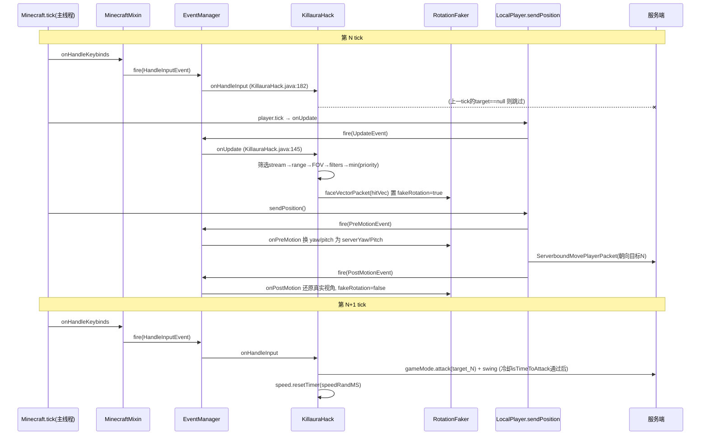
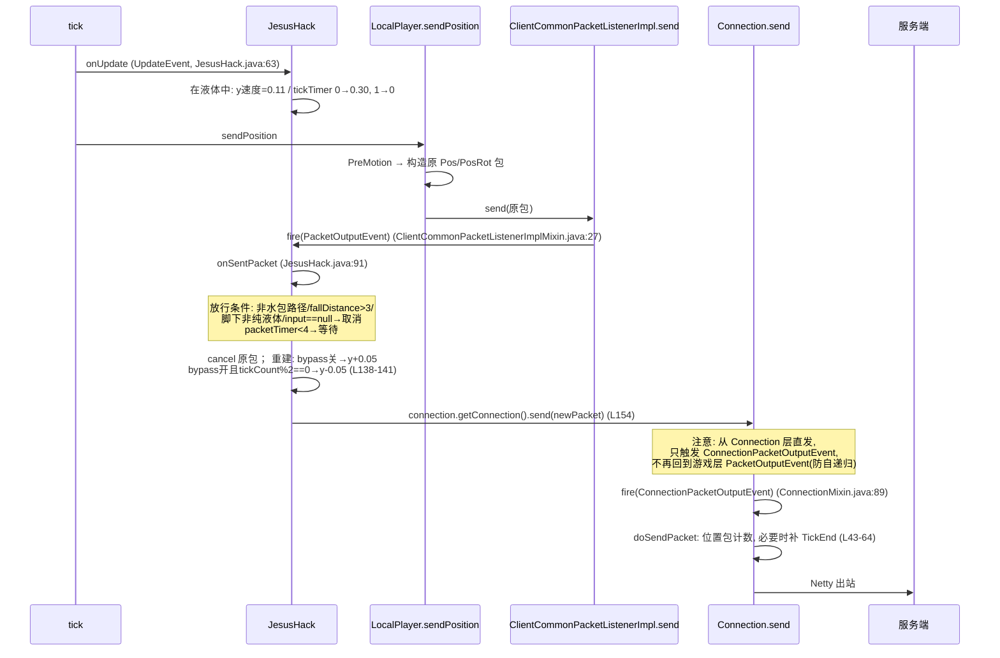
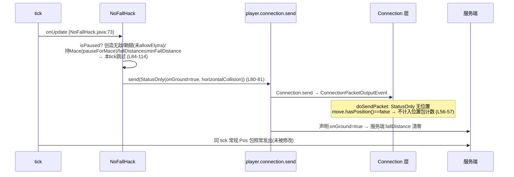
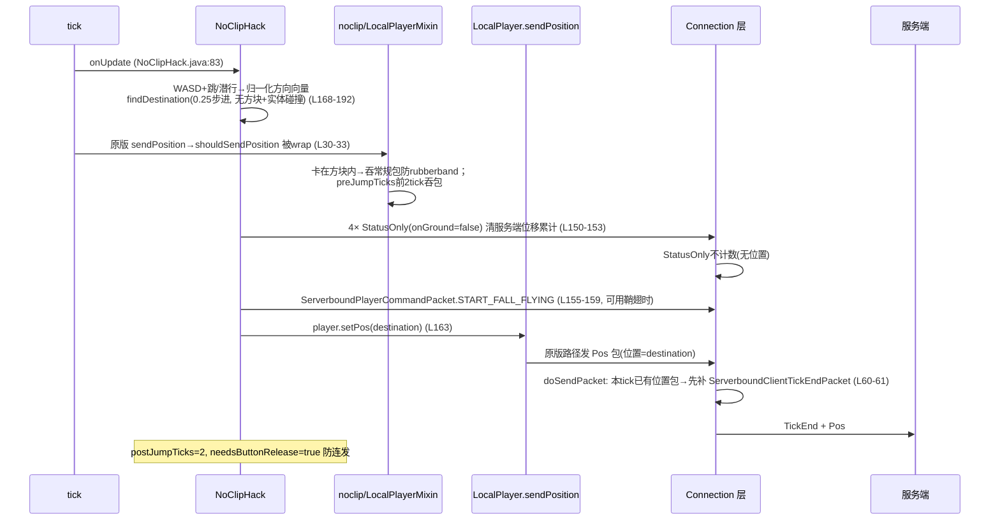
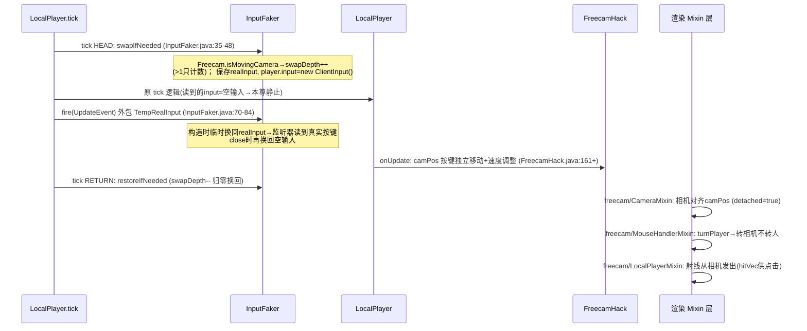
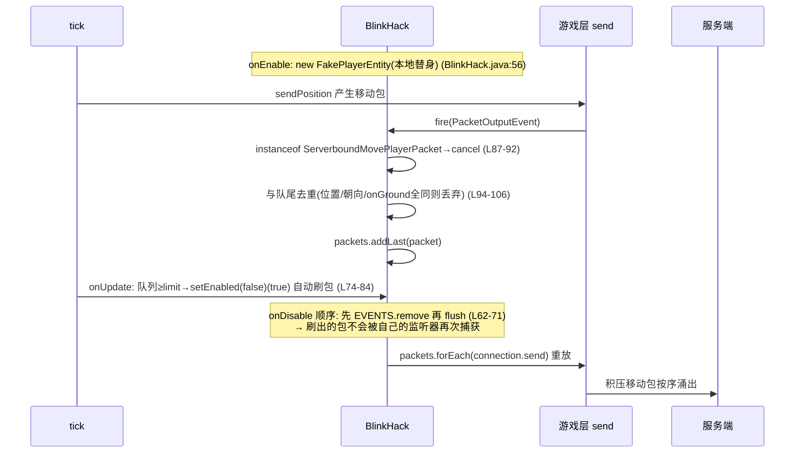

> 配套：[Wurst7-源码分析报告.md](../article.html?post=2026-10-21-Wurst7源码分析报告)（架构）、[Wurst7-功能实现详解.md](../article.html?post=2026-10-22-Wurst7功能实现详解)（逐功能机制）。本卷补充五部分：
> **A** 核心功能包时序图 · **B** 共享工具层与寻路引擎算法 · **C** 全部设置默认值总表 · **D** 52 命令语法表 · **E** 功能演进考古。
> 所有事实附 `文件:行号`（相对 `src/main/java/net/wurstclient/`）；推断标 `[推断]`。

---

## A. 核心功能包时序图

### A.0 tick 内事件顺序（所有图的前提）

```
Minecraft.tick()                                  ── 主线程，20 tick/s
├─ MinecraftMixin.onHandleKeybinds                ── fire HandleInputEvent
│    （注入点注释："Runs just before handleKeybinds()"，
│      即在 Gui.overlay 调用点，MinecraftMixin.java:81-97）
├─ ... handleKeybinds() / 键位处理 ...
└─ level.tick → player.tick（LocalPlayer.tick）
     ├─ InputFaker 输入交换（LocalPlayerMixin.java:50-72）
     ├─ fire UpdateEvent（LocalPlayerMixin.java:74-84，包裹 TempRealInput）
     └─ sendPosition()
          ├─ fire PreMotionEvent（:86-91）→ 此时确定移动包内容
          ├─ 发出 ServerboundMovePlayerPacket
          └─ fire PostMotionEvent（:91-96）
```

即同一 tick 内顺序恒为 **HandleInput → Update → PreMotion → 位置包 → PostMotion**。由此得出一个关键结论：Killaura 在 HandleInput 阶段的攻击，用的是**上一个 tick** Update 选出的目标——这构成一 tick 的选择/攻击延迟，也让"旋转先于攻击"天然成立（上一 tick 的 fakeRotation 已在上一 tick 的移动包中上报）。

### A.1 Killaura 攻击 tick（一 tick 延迟的攻速/旋转流水线）



**为什么这样设计**：攻击包（`ServerboundInteractPacket`）不含旋转，服务端用**最近收到的移动包朝向**判定命中面——把"瞄准"放在 N tick 的移动包、"攻击"放在 N+1 tick 的输入阶段，服务端看到的时间线就是"转头 → 挥击"，与真人一致。

### A2. Jesus 踩水 tick（包取消-重建路径）



### A3. NoFall（不改包、只补包）



**修正此前表述**：NoFall 的 StatusOnly 包**不依赖** TickEnd 补偿机制——`ConnectionMixin.onDoSendPacket` 只对 `hasPosition()` 的包计数（`ConnectionMixin.java:56-57`），StatusOnly 不占"每 tick 一位置包"名额，因此 NoFall 与常规移动包互不干扰。

### A4. NoClip 穿墙跳跃（多发位置包 + TickEnd 兜底）



**为什么需要 TickEnd**：这一 tick 内出现了 2 个位置包（队列里的 StatusOnly 不算，但 4×StatusOnly… 实际计数的是最终 Pos 包与可能存在的常规包）——26.3-snapshot-10 起服务端拒绝"单 tick 多位置包"（`ConnectionMixin.java:38-41` 注释），补发 TickEnd 让每个位置包都归属独立 tick。常量 √500/√1500 取自服务端 `handleMovePlayer()` 位移阈值（`NoClipHack.java:42-43`）。

### A5. Freecam（输入三层交换）



**为什么三层**：① 空输入让本尊不动（不发可疑移动包）；② TempRealInput 让其他 hack（如 AutoEat 的按键模拟）在事件回调里仍能读到真实按键状态；③ 引用计数 swapDepth 处理 tick/rideTick 嵌套交换（骑乘时两套 HEAD/RETURN，`LocalPlayerMixin.java:50-72`）。

### A6. Blink 扣包-刷包



**为什么有替身**：扣包期间客户端本地视角里"你自己"还在动，但服务端认为你静止——FakePlayerEntity 在扣包起点画一个静止替身，让客户端渲染与服务器认知一致（也是击退判定等的本地靶子 `[推断]`）。

---

## B. 共享工具层与寻路引擎

约 30 个 hack 复用的四个工具类 + A* 寻路引擎，是"放置/挖掘/寻路类为什么能通过服务端校验"的真正实现处。

### B.1 BlockBreaker（`util/BlockBreaker.java`）

**`getBlockBreakingParams(eyes, pos)`**（:75-137）——为一次挖掘计算全部服务端可见参数：

1. 取方块碰撞箱 `shape.bounds()`，算 6 个面的 hitVec（中心 + 半尺寸×方向，:85-97）；
2. **背面剪枝**：`distancesSq[i] >= distanceSqToCenter` 的面直接跳过 raytrace（:107-110，注释 "no need to raytrace the rear sides"）——背面不可能有视线，省一半 raycast；
3. 面选择两级优先：**先 LOS、后最近**（:115-133）；
4. 输出 record `BlockBreakingParams(pos, side, hitVec, distanceSq, lineOfSight)`（:139），附 `comparingParams()` 排序器（LOS 降序 → 距离升序，:152-156）供 Nuker/VeinMiner 多目标排序。

**`breakOneBlock`**（:44-56）三步：`RotationFaker.faceVectorPacket(hitVec)` → `gameMode.continueDestroyBlock(pos, side)` → SERVER 挥手。失败（返回 false）不重试不抛异常。

**`breakBlocksWithPacketSpam`**（:169-197）：对每块选一个**朝向玩家的面**（:184-186 与 BlockBreaker 同样的剪枝），直发 `START_DESTROY_BLOCK + STOP_DESTROY_BLOCK` 动作包对。`[推断]` 服务端在收到 STOP 时按其维护的挖掘进度结算——创造模式下 INSTANT 破坏合法，故一 tick 内任意多块都成立；生存模式则因进度不足被拒，这就是它只用于创造分支（Nuker/Kaboom/SpeedNuker）的原因。

### B.2 BlockPlacer（`util/BlockPlacer.java`）

**`getBlockPlacingParams(pos)`**（:54-179）——比挖掘复杂一档，因为放置需要一个**邻居方块作为支点**：

- 特例：目标位置本身可替换（草/水等）时直接对**自身**放，参数复用 `BlockBreaker.getBlockBreakingParams`（:57-75，源码注释"参数恰好与破坏相同"），`requiresSneaking = isInteractive(state)`（对着可交互方块放必须潜行，否则触发方块功能）；
- 常规：遍历 6 个邻居，邻居有碰撞箱且不可替换才算候选，hitVec = 邻居中心朝目标方向的面（:77-100）；
- 面选择**三级优先**（:136-170，源码注释完整解释了第一级）：
  1. **非交互邻居优先**——注释原文："sneaking can break line of sight → infinite sneak/unsneak loop otherwise"（:146-147）：潜行改变视角高度会破坏已算好的 LOS，导致下 tick 又不需要潜行、再下 tick 又需要的死循环；
  2. LOS 优先（:158-165）；
  3. **选最远的面**（:167-169，与挖掘的"最近"相反）——源码无解释；`[推断]` 放置 hitVec 在邻居上、越远说明越朝向目标方块的远侧，放置动作更不易与玩家自身碰撞箱/视线冲突。
- 输出 `BlockPlacingParams(neighbor, side, hitVec, distanceSq, lineOfSight, requiresSneaking)`（:181）。

### B.3 InteractionSimulator（`util/InteractionSimulator.java`）——**作者自述的防检测核心**

类 javadoc 原文（:19-27）："A utility class to turn right-clicking a block into a simple one-liner, **without sacrificing anti-cheat resistance** ... **Accurately replicates `Minecraft.startUseItem()` as of 26.3-snapshot-8**"——即该类是原版 `startUseItem` 的逐行为复刻，且注明对齐到的具体快照版本。

- `rightClickBlock(hitResult, swing)`（:67-82）：**主手→副手轮询**（与原版一致）；每手先试 `useItemOn`（方块交互），失败再试 `useItem`（物品使用）；
- `useItemOnAndSwing`（:119-141）：只在 `InteractionResult.Success && swingSource == PREDICTED` 时挥手（与原版挥手时机一致），并按需通知手持渲染器 `itemUsed`（物品数变化或创造模式）；
- javadoc 列出调用方须自行满足的 4 个原版前置条件（:54-65）：面向方块且无遮挡、`!isDestroying()`、`rightClickDelay` 置 4（**即使后续检查失败也要置**——复刻原版"点了就进冷却"的副作用）、`!isHandsBusy()`；
- 两个变体：自动选手（贴近原版）与强制指定手 `rightClickBlock(hitResult, hand, swing)`（:102-110）——javadoc 自述"这在原版不可能发生"，供必须指定手的 hack（AutoFarm 的副手补种等）使用。

`[推断]` 这个类存在的意义：服务端能观察到的是交互包的**序列形态**（哪只手、交互失败后是否继续试另一手、冷却何时开始），逐项复刻原版让 hack 产生的交互序列与手操不可区分。

### B.4 RotationUtils（`util/RotationUtils.java`）

- `getNeededRotations(vec)`（:44-57）：标准球面转角公式 `yaw = atan2(dz,dx)−90°`、`pitch = −atan2(dy,√(dx²+dz²))`，`Rotation.wrapped` 归一；
- **`getAngleToLastReportedLookVec`**（:89-99）：用 `yRotLast/xRotLast`（上一次**上报给服务端**的朝向）而非当前视角——注释解释载具时 last 值不更新故回退当前值。`[推断]` 语义是"服务端此刻认为你在看哪"：Tunneller 的 `placeBlockSimple` 等待条件（转向误差 >1° 等待）据此判定服务端是否已看到合法朝向；
- `isFacingBox(box, range)`（:105-110）：从眼位沿**服务器视线向量**（`getServerLookVec()`，取 RotationFaker 的假朝向，:38-42）做线段-盒 clip——KillauraLegit 判定"真的瞄准到了"用它；
- `slowlyTurnTowards(end, maxChange)`（:117-141）：双轴**比例限速**——yaw 与 pitch 各自的 maxChange 按两轴角差比例分配（:131-134），保证斜向转向时轨迹仍是直线而不是"先 pitch 后 yaw"的折线；
- `limitAngleChange`（:152-185）：两个重载。javadoc 两处直接写明动机："**Useful for smoothing out rotations and making combat hacks harder to detect**"（:146、:166）——即作者自述这两个函数是反检测组件；wrap 处理示例（179°→−179° 只需转 2°，:169-171）防止出现 358° 的瞬间大甩头（那是明显机器特征 `[推断]`）。

### B.5 PathFinder（`ai/PathFinder.java`）——A\* 寻路引擎

**核心状态**（:45-59）：`costMap`（g 值）、`prevPosMap`（前驱，用于回溯路径与掉落检查）、`PathQueue`（包装 `PriorityQueue` 的开放列表）。

**`think()`**（:81-111）：每次调用最多扩展 `thinkSpeed`（默认 **1024**）个节点；失败条件 `queue.isEmpty() || iterations >= thinkSpeed × thinkTime`（:118-121，默认 1024×200 = 20.48 万节点上限）。被调用方（FightBot 等）每 tick 调一次，即**计算被切分到多个游戏 tick**，避免单帧卡顿。

**`getNeighbors`**（:123-207）：12 方向邻居——4 正交 + 4 对角 + 上 + 下：
- 搜索边界：距起点 ±256 格（:128-130）；
- 对角移动要求两个中间正交格 `isPassableWithoutMining`（:218-231，防止穿墙角）；
- 向上要求上方两格可通行 +（飞行/着地/可攀爬）+ 目标在上方或有安全落点（:191-198）；
- 向下受 `canFallBelow` 坠落安全检查（:340-387）。

**成本函数 `getCost`**（:432-467）：基础 0.5+0.5=1；水 ×1.3164（乘在两格上）、岩浆 ×4.5395、脚下灵魂沙 ×2.5、需挖掘 ×2×2（脚+头两格）、对角 ×√2（1.4142135623730951）。这些系数形如实测速度比 `[推断]`（水中减速 30% → 1/0.76≈1.316；岩浆更慢）。

**启发式**（:469-475）：`1.001 × (dx+dy+dz − 0.5858×min(dx,dz))`——曼哈顿距离减去对角修正项（0.5858 = 2−√2），×1.001 轻微高估。`[推断]` 保持近乎 admissible（不漏最短路）的同时轻微偏向贪心，加速收敛。

**其他关键行为**：
- `canGoThrough`（:286-311）：区块未加载不可通行（防止对未加载区域规划路径）；**绊线/压力板视为不可通行**（:301-303，注释 "check if trapped"）；未无敌时岩浆/火不可通行；
- `canBeSolid`（:274-283）：支持 Jesus 联动——`abilities.jesus()` 时水/岩浆算可站立地面（:281-282），即**开着 Jesus 时寻路引擎把液体当地面**；
- `formatPath`（:512-543）：成功回溯 `prevPosMap`；**失败时选启发式最小的已处理节点**作为终点（:525-529）——"到不了目标就走到离目标最近处"，FightBot/Protect 依赖此行为接近敌人；
- `isPathStillValid(index)`（:599-623）：增量校验已格式化路径的每一步邻居关系是否仍成立（方块被挖/放后失效），PathProcessor 据此触发重算；
- `getProcessor()`（:625-631）：飞行能力 → `FlyPathProcessor`，否则 `WalkPathProcessor`。

### B.6 WalkPathProcessor（`ai/WalkPathProcessor.java`）——把路径变成按键

每 tick `process()`（:30-140）：

1. **定位**：`onGround` 时 y+0.5 对齐格心（:34-39）；
2. **index 推进**：走到路径点则 index++；`posIndex > index`（玩家超车，比如被击退又走回来）直接跳到 `posIndex+1`（:58-66）；`posIndex == -1`（不在路径上）计 `ticksOffPath`（:43-46，供调用方判定重算阈值，如 TreeBot 的 >20）；
3. `lockControls()` 接管全键盘 + `abilities.flying = false`（:68-69）；
4. `facePosition` 转向后**>90° 先等转身**（:72-75）——不边转边走；
5. **Jesus 联动**（:77-91）：目标更高且在液体中等 Jesus 上浮；低 >0.5 格时按 Shift 让 Jesus 的下潜分支工作——**hack 间协作的显式例子**；
6. 水平：keyUp；跳跃条件 = 上一路径点标记 `isJumping()` 或目标更高（:94-100）；
7. 垂直上：梯/藤 → `faceVectorClientIgnorePitch` 面向方块中心 + keyUp（原版攀爬只需面向）；普通方块 → **方向性跳跃**（跳过路径中悬空中间节点 index++ 再 keyJump，:117-126；:108 有 `// TODO: Spider` 爬墙寻路未实现）；
8. 垂直下：**跳过所有悬空节点直达底部**再 keyUp 走下边缘（:129-139）——不逐格下跳；
9. `canBreakBlocks()` = onGround（:142-146）：只在地面允许顺路挖挡路方块（挖掘会打断移动）。

### B.7 寻路引擎补遗：基类与飞行版（`ai/` 其余四个文件）

**PathProcessor 基类**（`ai/PathProcessor.java:19-82`）：
- `CONTROLS` 静态数组固定 6 键（前后左右跳潜，:24-26）；
- `lockControls()`（:66-74）：全部 `setDown(false)` + `setSprinting(false)`；`releaseControls()`（:76-81）用 `IKeyMapping.resetDownState()`——**两个不同的"松键"**：lock 只置 false（保留 actuallyDown 状态语义），release 彻底复位（供寻路结束后交还玩家控制时清残留）；
- `facePosition`（:60-64）：`RotationFaker.faceVectorClientIgnorePitch`——寻路面向只管水平角；
- 状态三件套：`index`（当前路径步）、`done`、`ticksOffPath`（供调用方判定重算阈值）。

**FlyPathProcessor**（`ai/FlyPathProcessor.java:30-159`）——与 Walk 版的五点差异：
1. **到达判定用小碰撞盒**而非格心：`nextBox = (x+0.3, y, z+0.3) ~ (x+0.7, y+0.2, z+0.7)`（:37-39）——飞行不落格，0.4 格判定窗 + 0.2 格高度窗足够；
2. **换向急刹**（创造飞行）：进入新节点瞬间三轴速度各 `÷ max(|v|×50, 1)`（:58-66）——模拟创造飞行低惯性，防过冲冲出窄路径 `[推断]`（源码注释只写 "stop when changing directions"）；
3. **转向容差 1°**（Walk 版为 90°，:85-87）——飞行时偏航一格就飞偏，必须先对准；
4. **FlightHack 联动**（非创造飞行）：距目标点 ≤ Flight 的水平/垂直速度设置时直接 `setPos` 吸附（:117-122,135-140）——按 hack 当前速度折算"一步到位"的距离；
5. **碰撞处理**：水平碰撞按相对高度按 Shift（目标在下）或 Jump（目标在上）绕行（:126-130）；垂直碰撞松 Shift 转 keyUp（:147-151）；`canBreakBlocks()` 恒 true（:155-159，飞行中随时可挖挡路方块）。

**PathQueue**（`ai/PathQueue.java`）：`PriorityQueue<Entry(pos, priority)>` 的薄包装，`toArray()` 供 `.path -debug` 渲染开放列表（PathFinder.renderPath :563-571）。

**PathPos**（`ai/PathPos.java`）：`BlockPos` + `jumping` 标志；**equals/hashCode 把 jumping 纳入**（同一格"走过"与"跳过"是两个不同节点）——Walk 版的跳跃决策（"上一路径点是跳跃节点则起跳" :98-99）依赖此标志在 costMap/prevPosMap 中正确区分。

---

## C. 全部设置默认值总表

> 数据源：各 hack 构造器中的 `new XxxSetting(...)` 调用（103 个 hack 有直接设置，53 个无设置；AutoFarm 21 项作物设置、ChestESP 14 组、Nuker 系共用 CommonNukerSettings 已合并）。格式：`名称=默认值 (范围)`。

**A**：AimAssist: Range=4.5 (1–6), RotationSpeed=600°/s (10–3600), FOV=120° (30–360), AimAt=AUTO, IgnoreMouseInput=0%, CheckLOS=true, AimWhileBlocking=false, filters(25) · AirPlace: Range=5 (1–6), Guide=true, GuideColor=RED · AnchorAura: Range=6 (1–6), AutoPlace=true, CheckLOS=false, FaceTarget=OFF, InteractSwing=CLIENT, TakeItemsFrom=INVENTORY, filters(18) · AntiAfk: UseAI=true, AIRange=16 (1–64), NonAIRange=1 (1–64), WaitTime=2.5s (0–60), WaitTimeRand=±0.5s (0–60), ShowWaitTime=true · AntiBlind: 无 · AntiCactus: PreventCactusTopDamage=true · AntiEntityPush/AntiHunger/AntiSpam/AntiWobble: 无 · AntiKnockback: HStrength=100% (-100–200), VStrength=100% (-100–200) · AntiWaterPush: PreventSlowdown=true · ArrowDmg: Strength=10 (0.1–10), YeetTridents=false · AttributeSwap: Mode=SIMPLE, TargetSlot=1 (1–9), SwapBack=true, SwapBackDelay=2 (0–20), BreachSwapping=true, ShieldBreaker=true, ItemSaver=true, OnlyWithKillaura=false · AutoArmor: UseEnchantments=true, SwapWhileMoving=false, Delay=2 (0–20) · AutoBuild: Template=autobuild/, Range=6 (1–10), CheckLOS=false, UseSavedBlocks=true, FaceTarget=SERVER, InteractSwing=SERVER, FastPlace=true, StrictBuildOrder=false · AutoComplete: Model=GPT_4O_2024_08_06, MaxTokens=16 (1–100), Temperature=1 (0–2), TopP=1 (0–1), PresencePenalty=0 (-2–2), FrequencyPenalty=0 (-2–2), MaxSuggestionsPerDraft=3 (1–10), MaxSuggestionsKept=100 (10–1000), MaxSuggestionsShown=5 (1–10) · AutoDrop: Items=19 项花卉类 · AutoEat: TargetHunger=10 (0–10), MinHunger=6.5 (0–10), InjuredHunger=10 (0–10), InjuryThreshold=1.5 (0.5–10), AllowOffhand=true, EatWhileWalking=false, AllowHunger=true, AllowPoison=false, AllowChorus=false · AutoFarm: Range=5 (1–6), CheckLOS=false, FaceTarget=SERVER, AttackSwing=SERVER, InteractSwing=SERVER, DrawReplanting/Harvest/Replant=true，作物 21 项（主粮类默认 harvest+replant 双 true；Weeping/Twisting vines 默认 harvest=false）+ AllPlantTypes 批量 · AutoFish: BiteMode=SOUND, ValidRange=1.5 (0.25–8), CatchDelay=0 (0–60), RetryDelay=15 (0–100), Patience=60s (10–120), ShallowWaterWarning=true, mcMMOMode=false, mcMMORange=3 (1–50), mcMMORangeBug=true, mcMMOLimit=10 (2–1000) · AutoLeave: Health=4 心 (0.5–9.5), Mode=QUIT, DisableAutoReconnect=true, Totems=11=忽略 (0–11) · AutoLibrarian: WantedBooks=11 本（depth_strider;3, efficiency;5, feather_falling;4 等）, LockInTrade=false, UpdateBooks=REMOVE, Range=5 (1–6), FaceTarget=SERVER, AttackSwing=SERVER, InteractSwing=SERVER, RepairMode=1 (0–100) · AutoMine: SuperFastMode=false · AutoPotion: Health=6 心 (0.5–9.5) · AutoReconnect: WaitTime=5s (0–60) · AutoRespawn: DeathScreenButton=true · AutoSign: 无 · AutoSoup: Health=6.5 (0.5–9.5) · AutoSprint: Omni=false, Hungry=false · AutoSteal: Delay=100ms (0–500), Buttons=true, ReverseSteal=false · AutoSwim/AutoSwitch/AutoWalk: 无 · AutoSword: Priority=SPEED, SwitchBack=true, ReleaseTime=10 (1–200) · AutoTool: UseSwords=false, UseHands=true, RepairMode=0=off (0–100), SwitchBack=false · AutoTotem: ShowCounter=true, Delay=0 (0–20), Health=0=忽略 (0–10)

**B**：BarrierEsp: 无 · BaseFinder: NaturalBlocks=40 项, Color=RED · Blink: Limit=0=disabled (0–500) · BoatFly: ChangeForwardSpeed=false, ForwardSpeed=1 (0.05–5), UpwardSpeed=0.3 (0–5) · BonemealAura: Range=5 (1–6), MultiMeal=false, CheckLOS=true, FastPlace=true, UseWhileBreaking=false, UseWhileRiding=false, Saplings/Crops/Stems/Cocoa/SeaPickles=true, Other=false · BowAimbot: Priority=ANGLE_DIST, PredictMovement=20% (0–200%), filters(25), Color=RED · BuildRandom: Range=5 (1–6), MaxAttempts=128 (1–1024), CheckItem=true, CheckLOS=false, FaceTarget=SERVER, InteractSwing=SERVER, FastPlace=false, PlaceWhileBreaking=false, PlaceWhileRiding=false, Indicator=true · BunnyHop: JumpIf=SPRINTING

**C**：CameraDistance: Distance=12 (-0.5–150) · CameraNoClip: 无 · CaveFinder: Area=A11, Limit=5 (3–6 对数), Color=RED, Opacity=0=呼吸 (0–1) · ChatTranslator: Translate=RECEIVED, YourLang=ENGLISH, OtherLang=CHINESE_SIMPLIFIED, AutoDetect 收/发=true, FilterOwn=true · ChestESP: Style=BOXES；14 组全 Include=true，色：Normal=GREEN, Trap=RED, Ender=CYAN, 矿车/船=YELLOW, Barrel/Pot=GREEN, Shulker=MAGENTA, 漏斗/投掷器/发射器/合成器/熔炉=WHITE · ClickGui: BG=0x404040, Accent=0x101010, Text=0xF0F0F0, Opacity=50% (15–85), TTOpacity=75% (15–100), MaxHeight=200 (0–1000) ×2 · ClickAura: Range=5 (1–10), Speed=0=auto, Priority=ANGLE, FOV=360° (30–360), filters(26) · CrashChest: 无 · CreativeFlight: AntiKick=false, Interval=30 (5–80), Distance=0.07 (0.01–0.2) · Criticals: Mode=PACKET · CrystalAura: Range=6 (1–6), AutoPlace=true, CheckLOS=false, FaceTarget=OFF, AttackSwing=CLIENT, InteractSwing=CLIENT, TakeItemsFrom=INVENTORY, filters(18)

**D–F**：Derp/Dolphin: 无 · Excavator: Range=5 (2–6), Mode=FAST · ExtraElytra: InstantFly=true, SpeedCtrl=true, HeightCtrl=true, StopInWater=true · FancyChat: 无 · FastBreak: ActivationChance=100% (0–1), LegitMode=false · FastLadder/FastPlace: 无 · FeedAura: Range=5 (1–10), FilterBabies=true, FilterUntamed=false, FilterHorses=false · FightBot: Range=4.25 (1–6), Speed=0=auto, AttackSwing=CLIENT, Distance=3 (1–6), UseAI=false, PauseOnContainers=true, filters(26) · Fish: 无 · Flight: HSpeed=1 (0.05–10), VSpeed=1 (0.05–5), AllowUnsafeVSpeed=false, Scroll=true, RenderSpeed=true, AntiKick=false, Interval=70 (5–80), Distance=0.035 (0.01–0.2) · Follow: Distance=1 (1–12), UseAI=false, filters(20) · ForceOp: 无 · Freecam: ApplyInputTo=CAMERA, InteractFrom=CAMERA, HSpeed=1 (0.05–10), VSpeed=1 (0.05–5), Scroll=true, RenderSpeed=true, InitialPos=INSIDE, Tracer=false(色=WHITE), HideHand=true, DisableOnDamage=true, ReloadChunks=true · Fullbright: Method=GAMMA, Fade=true, DefaultGamma=50% (0–1)

**G–J**：Glide: FallSpeed=0.125 (0.005–0.25), MoveSpeed=120% (1–5), MinHeight=0=off (0–2), PauseOnSneak=true · HandNoClip: Blocks=24 项容器类 · HeadRoll/HealthTags: 无 · HighJump: Height=6 (1–100) · InfiniChat: 无 · InstaBuild: Template=autobuild/, Range=6 (1–10), UseSavedBlocks=false · InstantBunker: 无 · InvWalk: AllowClickGUI=true, AllowOther=true, AllowSneak/Sprint/Jump=true · ItemEsp: Style=BOXES, BoxSize=FANCY, Color=YELLOW · ItemGenerator: Speed=1 (1–36), StackSize=1 (1–64)

**J–K**：Jesus: NoCheat+Bypass=false · Jetpack: 无 · Kaboom: Power=128 (32–512), Sound=true, Particles=true · KillPotion: PotionType=SPLASH · Killaura: Range=5 (1–10), Speed=0=auto (0–20), SpeedRandMS=±100 (0–1000), Priority=ANGLE, FOV=360° (30–360), AttackSwing=CLIENT, DamageIndicator=true, PauseOnContainers=true, CheckLOS=false, filters(26) · KillauraLegit: Range=4.25 (1–4.25), Speed=0=auto, SpeedRandMS=±100, RotationSpeed=600°/s (10–3600), Priority=ANGLE, FOV=360°, AttackSwing=CLIENT（无 OFF 选项）, DamageIndicator=true, filters(25 严格默认：Creative/Sleeping=true, Flying=0.5)

**L–N**：Liquids/Lsd/MaceDmg: 无 · MassTpa: Command=/tpa, Delay=20 (1–200), IgnoreErrors=false, StopWhenAccepted=true · MileyCyrus: TwerkSpeed=5 (1–10) · MobEsp: Style=BOXES, BoxSize=FANCY, filters(19, ArmorStands=true 其余 false) · MobSpawnEsp: Area=A9, NightColor=YELLOW, DayColor=RED, Opacity=50% (0–1), DepthTest=true, HitboxCheck=OFF · MultiAura: Range=5 (1–6), Speed=0=auto, FOV=360°, AttackSwing=CLIENT, PauseOnContainers=false, filters(26) · NameProtect: 无 · NameTags: Scale=100% (0.05–5), UnlimitedRange=true, SeeThrough=false, ForceMobNametags=true, ForcePlayerNametags=false · Navigator: 无 · NewChunks: Style=OUTLINE, Show=NEW, ShowReasons=false, ShowCounter=false, Altitude=0 (-64–320), DrawDistance=32 (8–64), Opacity=75% (10–100), NewColor=RED, OldColor=BLUE, Log=false · NoBackground: AllGUIs=false · NoClip: ShowPassableBlocks=true · NoFall: AllowElytra=false, PauseForMace=false, MinFallDistance=1 (0–10), MinElytraFallDistance=2 (0–10) · NoFireOverlay: Offset=0.6 (0.01–0.6) · NoFog/NoHurtcam/NoLevitation/NoOverlay/NoPumpkin/NoSlowdown/NoVignette/NoWeb: 无 · NoShieldOverlay: BlockingOffset=0.5 (0–0.8), NonBlockingOffset=0.2 (0–0.5) · NoWeather: DisableRain=true, ChangeTime=false (Time=6000, 0–23900), ChangeMoonPhase=false (Phase=0, 0–7) · Nuker: Range=5 (1–6) + 共通（Shape=SPHERE, Flat=false, Mode=NORMAL, ID=air, LockID=false, MultiIDList=24 项矿石, AttackSwing=SERVER）· NukerLegit: Range=4.25 (1–4.5) + 同上共通

**O–P**：OpenWaterEsp/Overlay/Panic: 无 · Parkour: MinDepth=0.5 (0.05–10), EdgeDistance=0.001 (0.001–0.25), JumpWhileSneaking=false · PlayerEsp: Style=LINES_AND_BOXES, BoxSize=FANCY, filters(3: Creative/Sleeping/Invisible 均 false) · PortalEsp: Style=BOXES, 四组 Include=true（色：下界=RED, 末地=GREEN, 框=BLUE, Gateway=YELLOW）, Area=A11 · PortalGui/ProphuntEsp: 无 · Protect: Speed=0=auto, AttackSwing=CLIENT, UseAI=false, PauseOnContainers=true, filters(26)

**R–S**：Radar: Radius=100 (1–100), Rotate=true, filters(13, Bats=true 其余 false) · RainbowUi: 无 · Reach: Range=6 (1–10) · RemoteView: InteractFrom=CAMERA, HideHand=true · Restock: Items=minecart, Slot=0 (-1–9), Amount=1 (1–64), RepairMode=0=off (0–100) · SafeWalk: SneakAtEdges=false, EdgeDistance=0.05 (0.05–0.25) · ScaffoldWalk: 无 · Search: Block=diamond_ore, Area=A11, Limit=4 (3–6 对数) · SkinDerp: 无 · Sneak: Mode=LEGIT, OffWhileFlying=false · SnowShoe: 无 · SpeedHack: 无 · SpeedNuker: Range=5 (1–6) + 共通, AttackSwing=OFF · Spider: 无 · Step: Mode=LEGIT, Height=1 (1–10, 仅 Simple)

**T–X**：TemplateTool: 无 · Throw: Amount=16 (2–1000000) · Tired: 无 · Tillaura: Range=5 (1–6), MultiTill=false, CheckLOS=true · Timer: Speed=2 (0.1–20) · TooManyHax: 无 · TpAura: Range=4.25 (1–6), Speed=0=auto, Priority=ANGLE, AttackSwing=CLIENT, PauseOnContainers=true, filters(26) · Trajectories: MissColor=GRAY, EntityHitColor=RED, BlockHitColor=GREEN · TreeBot: Range=4.5 (1–6), AttackSwing=SERVER · TriggerBot: Range=4.25 (1–6), Speed=0=auto, SpeedRandMS=±100, AttackSwing=CLIENT, AttackWhileBlocking=false, SimulateMouseClick=false, filters(26) · TrueSight: 无（17 项 filters）· TrollPotion: PotionType=SPLASH · Tunneller: Size=3x3, Limit=0=disabled (0–1000), Torches=false

**V–X**：VeinMiner: Range=5 (1–6), Flat=false, MultiIDList=24 项, AttackSwing=SERVER, MaxVeinSize=64 (1–1000), CheckLOS=false · XRay: Ores=71 项, OnlyExposed=false, Opacity=0=off (0–0.99)

**OTF 设置**：DisableOtf: HideEnableButton=false · HackListOtf: Mode=AUTO, Position=LEFT, Color=WHITE, SortBy=NAME, Reverse=false, Animations=true · NoChatReportsOtf: DisableSignatures=true · NoTelemetryOtf: DisableTelemetry=true · TabGuiOtf: Status=DISABLED · TranslationsOtf: ForceEnglish=true · VanillaSpoofOtf: SpoofVanilla=false · WurstLogoOtf: BG=WHITE, Text=BLACK, Visibility=ALWAYS · ZoomOtf: Level=3x (1–50), MouseWheel=true, InScreens=false, Key=key.keyboard.v（其余 OTF 无设置）

**全局默认键位 14 条**（`keybinds/KeybindList.java createDefaultKeybinds()`）：b=fastplace;fastbreak · c=fullbright · g=flight · ;=speednuker · h=say /home · j=jesus · k=multiaura · n=nuker · r=killaura · RightShift=navigator · RightCtrl=clickgui · u=freecam · x=x-ray · y=sneak

---

## D. 52 命令语法表（`commands/`，取自各命令 super() 的 syntax 字段）

| 命令 | 语法 | 备注 |
|---|---|---|
| .addalt | `.addalt <player>` | `all` 添加全服玩家 |
| .annoy | `.annoy <player>` | 关闭：`.annoy` |
| .author | `.author <author>` | 创造模式改成书作者 |
| .bind | `.bind <key> <hacks/commands>` | `.binds add` 快捷；多值用 `;` |
| .binds | `.binds add/remove/list/load-profile/save-profile/list-profiles/remove-all/reset` | profile 存 `wurst/keybinds/` |
| .blink | `.blink [on\|off]` / `.blink cancel` | cancel=丢弃队列回原位 |
| .blocklist | `.blocklist <feature> <setting> add/remove/list/reset` | 例：`.blocklist Nuker MultiID_List add gravel` |
| .clear | `.clear` | 彻底清聊天 |
| .copyitem | `.copyitem <player> <slot>` | slot: hand/head/chest/legs/feet；创造 |
| .damage | `.damage <amount>` | 半心单位；多次叠加 |
| .dig | `.dig <length> <width> <height>` / `.dig stop` | 前左上角起挖 |
| .drop | `.drop` / `.drop slow` | 帮助文本明说：普通模式被踢就用 slow |
| .enabledhax | `.enabledhax load/save-profile/list-profiles` | 存 `wurst/enabled hacks/` |
| .enchant | `.enchant` | 全附魔（丝触/诅咒除外）；创造 |
| .excavate | `.excavate <x1> <y1> <z1> <x2> <y2> <z2>` | 两角定区域 |
| .features | `.features` | 功能统计 |
| .follow | `.follow <entity>` | FollowCmd 设置目标 |
| .friends | `.friends add/remove/remove-all/list` | 好友管理 |
| .getpos | `.getpos` / `.getpos copy` | 复制坐标 |
| .give | `.give <item/id> [<amount>] [<nbt>]` | 自定义 NBT；创造 |
| .gm | `.gm <gamemode>` | `/gamemode` 快捷 |
| .goto | `.goto <x> <y> <z>` / `.goto <entity>` / `.goto -path` | A* 寻路 |
| .help | `.help <command>` / `.help [<page>]` | |
| .invsee | `.invsee <player>` | 看他人背包（服务端数据允许的部分） |
| .ip | `.ip` / `.ip copy` | |
| .itemlist | `.itemlist <feature> <setting> add/remove/list/reset` | |
| .jump | `.jump` | |
| .leave | `.leave` | 立即断开 |
| .modify | `.modify set/remove <type> <value>` | 物品组件数据；`$`=颜色码 |
| .path | `.path <x> <y> <z>` / `.path <entity>` / `.path -debug/-depth/-refresh` | 寻路可视化 |
| .potion | `.potion add/set (<effect> <amplifier> <duration>)... / remove <effect>` | 改手持药水 |
| .protect | `.protect <entity>` | ProtectHack 目标 |
| .rename | `.rename <new_name>` | `$`=颜色码 |
| .repair | `.repair` | 创造 |
| .rv | `.rv [entity]` | RemoteView 目标 |
| .say | `.say <message>` | 强制发送 `.` 开头文本 |
| .setblock | `.setblock <feature> <setting> <block>` / reset | |
| .setcheckbox | `.setcheckbox <feature> <setting> (on\|off\|toggle)` | |
| .setcolor | `.setcolor <feature> <setting> <RGB>` | 例 `#FF0000` |
| .setmode | `.setmode <feature> <setting> <mode> / (prev\|next)` | |
| .setslider | `.setslider <feature> <setting> <value> / (more\|less)` | |
| .settings | `.settings load/save-profile/list-profiles` | 存 `wurst/settings/` |
| .sv | `.sv` | 服务器品牌/版本 |
| .t | `.t <hack> [on\|off]` | 切换 hack |
| .taco | `.taco` | 快捷栏跳舞 taco 彩蛋 |
| .toomanyhax | `.toomanyhax block/unblock/block-all/unblock-all/list/load/save-profile/list-profiles` | 黑名单管理 |
| .tp | `.tp <x> <y> <z>` / `.tp <entity>` | 上限 22 格 |
| .unbind | `.unbind <key>` | |
| .vclip | `.vclip <height>` / `.vclip (up\|down)` | 上限 10 格 |
| .viewcomp | `.viewcomp` / `.viewcomp type <query>` / `.viewcomp copy` | 组件数据 |
| .viewnbt | `.viewnbt` / `.viewnbt copy` | NBT 数据 |
| .xray | `.xray add/remove/list/reset` | `.blocklist X-Ray Ores` 快捷 |

---

## E. 功能演进考古（源码残骸与版本绑定证据）

### E.1 被注释掉的实现：Sneak 的 PACKET 模式
`hacks/SneakHack.java` 保留了完整的死代码：设置项描述仍写着 "Packet mode makes it look like you're sneaking without slowing you down"（:24-25），枚举 `PACKET/LEGIT` 仍在（:129-133），但全部发送逻辑被注释（onPreMotion :91-92、onPostMotion :100-104、`sendSneakPacket` :121-127）。注释代码里是发 `PRESS_SHIFT_KEY / RELEASE_SHIFT_KEY` 命令包的旧实现，且用的是**旧 Yarn 命名 `ClientCommandC2SPacket`**——说明该死代码早于本项目的 Mojang 映射迁移，是从旧版源码搬运时被注释的。`[推断]` 废弃原因：服务端普遍校验潜行姿态与实际碰撞箱/速度的一致性，纯包伪装（不减速却"潜行"）特征过于明显——此推断无法从本仓库验证。现版本仅剩 LEGIT（真实按键潜行）。

### E.2 SpeedHack 的模式删除
本版本 `SpeedHackHack.java` 无模式枚举（源码注释 :62-66：上限 0.66 是"NoCheat+ 3.13.0 可过的最高值，3.13.2 已修复"）——说明旧版曾有多个模式/参数档位，随反作弊版本演进而被收敛为单一保守实现。这是"作者跟随反作弊版本调整"的直接证据。

### E.3 "NoVelocity" 的下落
本仓库无 Velocity 功能；`hacks/AntiKnockbackHack.java:17` 的 `@SearchTags({"anti knockback", "AntiVelocity", "anti velocity", "NoKnockback", ...})` 表明旧版 Wurst（2.x 时代）的 Velocity 功能在 Wurst7 中被改名/合并为 AntiKnockback，旧名字保留为搜索别名（网络检索与本地源码双重佐证）。

### E.4 上游 MC API 变更的追踪
`util/WurstBufferSource.java:26` 注释："...`MultiBufferSource` which was removed in 26.2-snapshot-5"——MC 26.2 快照移除了原版多缓冲源接口，Wurst 自建了替代品。`util/InteractionSimulator.java:24` 自述复刻 "26.3-snapshot-8" 的 `startUseItem`；`ConnectionMixin.java:39` 注释引用 "Since 26.3-snapshot-10" 的服务端位置包限制。三处注释精确到快照号，说明本源码树紧跟 26.x 快照周期逐版适配。

### E.5 未完成的 TODO 清单（作者自认的缺口）
- `ai/WalkPathProcessor.java:108` — `// TODO: Spider`（寻路不接 Spider 爬墙）；
- `hacks/AnchorAuraHack.java:135,150,169` — 充能后同 tick 引爆的"等下一 tick"选项（×2）、放置速度上限；
- `hacks/CrystalAuraHack.java:157` — 放置速度上限（同 AnchorAura）；
- `hacks/TreeBotHack.java:379` — `// ignore large trees (for now)`（>6 根的大树放弃）；
- `util/ItemUtils.java:69` — AutoSword 未来改用 `calculateModifiedAttribute()` 计算伤害（现为硬编码优先级表）。

### E.6 `@DontSaveState` 的 17 个功能（状态不持久化）
AntiAfk、AntiHunger、AutoSign、Blink、ClickGui、ForceOp、FightBot、Follow、Freecam、Lsd、MassTpa、Navigator、Protect、RemoteView、SpeedNuker、TreeBot、Tunneller。
`[推断]` 共性：恢复启用要么危险（Blink 恢复即瞬刷最多 500 个积压包、Tunneller 凭空从旧坐标继续挖、AntiHunger 单独开会干扰移动校验），要么依赖会话上下文（Protect/Follow 的目标实体、ForceOp 的密码会话、MassTpa 的玩家列表），要么本来就是"打开即关"的 UI（ClickGui/Navigator）。`hack/Hack.java:25-26` 的判定是注解反射。

### E.7 功能互斥网络（onEnable 强制关闭，源码实证的 25+ 条边）
AimAssist→关 AutoFish+8 aura；Killaura→关 9 个；KillauraLegit→同；MultiAura/TpAura/TriggerBot/CrystalAura/Protect/FightBot→各关同类；AutoEat→AutoSoup；AutoFish→AntiAfk+AimAssist；NoFall→AntiHunger；Parkour→SafeWalk（SafeWalk onEnable 也关 Parkour，`hacks/SafeWalkHack.java:46`——**双向互斥**）；Jetpack→Flight+CreativeFlight；BowAimbot→Excavator+TemplateTool；AutoBuild→InstaBuild+TemplateTool；InstaBuild→AutoBuild+TemplateTool；TemplateTool→AutoBuild+InstaBuild+BowAimbot+Excavator；Nuker→AutoMine+Excavator+NukerLegit+SpeedNuker+Tunneller+VeinMiner；Tunneller→onUpdate 每 tick 强制关 7 个（`hacks/TunnellerHack.java:158-162`，最激进）；Derp/HeadRoll/Tired 三者互斥；HeadRoll→Derp+Tired；Lsd→RemoteView；RemoteView/Freecam→互相关闭（RemoteView 关 Freecam+Lsd）；BowAimbot 与 Excavator/TemplateTool。`[推断]` 归纳两条设计规则：① 同类功能（同 Category 且操作同一游戏层）互斥防叠加出包冲突；② 接管键盘/视角的（Tunneller、寻路系）连带关闭所有会被自己输入覆盖的功能。

### E.8 命令补全的职责转移
本仓库无旧版的 `CmdSuggestor`/Tab 补全类；`.` 命令不参与原版 brigadier 补全，唯一在聊天框出现的"建议"来自 AutoComplete 的 OpenAI 注入（`mixin/autocomplete/CommandSuggestionsMixin.java:26-50`，把 LLM 建议回填原版 `CommandSuggestions`）。命令发现靠 `.help`/Navigator/ClickGUI。

---

## 附1：算法图解（文字图）

> 用纯文字图解释 B 节和功能详解里的算法类内容。图内数字为示意，精确行为以源码为准。

### 图1：A\* 的三张表与 f = g + h

```
PathFinder 内部的三张表 (ai/PathFinder.java:49-51)
------------------------------------------------------------
 costMap    : PathPos -> float    g 值 = 从起点走到该格的实际成本
 prevPosMap : PathPos -> PathPos  前驱指针 = 该格"从哪来"(回溯路径用)
 PathQueue  : 优先队列            开放列表 = 按 f 从小到大出队
------------------------------------------------------------

f = g + h
    |   |
    |   +-- h (启发式, getHeuristic :469-475):
    |         h = 1.001 x (dx + dy + dz - 0.5858 x min(dx,dz))
    |         (曼哈顿距离 - 对角修正; x1.001 轻微高估,
    |          近乎不错失最短路又略偏向贪心 [推断])
    |
    +-- g = costMap[当前格] + getCost(当前格, 下一格)

getCost 的权重 (:432-467):           对角移动:
   水       x 1.3164 (每格)             斜穿一格 = x 1.4142 (√2)
   岩浆     x 4.5395 (每格)             且要求两个相邻正交格
   脚下灵魂沙 x 2.5                      均可通行且无需挖掘
   需挖掘    x 2 (脚) x 2 (头)
```

### 图2：扩展波纹——A\* 为什么"绕得开墙"

```
俯视图, 一格一字符; 数字 = 出队批次(同批可并列), # = 固体
开放列表按 f 排序 → 波纹总朝"离 G 近"的方向流动:

        0    1    2    3    4
     +------------------------+
  0  | S    1    2    3    4  |   直路上 f 最小, 扩展一路领先
     |                        |
  1  | 1    #    #    #    5  |   波纹撞墙: 墙格 isPassable=false,
     |                        |   永不入队 → 波纹自动绕行
  2  | 2    #    G    #    6  |
     |                        |
  3  | 3    4    5    6    7  |   绕墙的 f 略大, 晚几步才扩展到
     +------------------------+

 每次 poll 后比较 current == goal (:93-94)
 → 波纹一碰到 G 即 done=true, 后续节点不再扩展
```

### 图3：think() 单次调用流程（被各 hack 每 tick 调一次，分片计算）

```
                每 tick 调一次 think() (ai/PathFinder.java:81-111)
                                |
                +--- 队列空? 或 迭代数 >= 1024x200? ---是---> failed
                |                否
                v      (本次最多出队 thinkSpeed = 1024 个节点)
          poll() 取 f 最小的节点 current
                |
          current == goal ? ---是---> done, 结束本次 think
                | 否
                v
          getNeighbors(current) — 12 方向
          (4 正交 + 4 对角 + 上 + 下; 各自过通行性/安全检查)
                |
          对每个 next:
             newCost = costMap[current] + getCost(current, next)
             next 已有更小的 g? ---是---> 跳过 (不去重就是死循环)
                | 否
                v
             costMap[next]   = newCost
             prevPosMap[next] = current        <== 记住"从哪来"
             queue.add(next, newCost + h(next))
```

### 图4：路径重建与"失败也不放弃"

```
成功路径: formatPath() 沿 prevPosMap 从终点回溯到起点, 再反转
   start --> ... --> prev --> prev --> current(=goal)
   之后由 PathProcessor 按 path.get(index) 逐格执行

失败路径 (队列空 / 迭代超限):
   不返回空 —— 在全部已处理节点中选 h 最小者当终点 (:525-529)
   效果: "到不了目标就走到离目标最近的可站立处"
   FightBot / Protect 的"贴近敌人"行为依赖这一点
```

### 图5：Killaura 目标筛选漏斗（每 tick）

```
 所有实体
    |  EntityUtils.getMeleeAttackableEntities()
    |  (排除自己/死亡/不可攻击; 好友过滤在 EntityUtils.java:89)
    v
 [ range ]     distanceToHitboxSq <= Range^2    默认 5^2
    |          注意: 是到"碰撞盒"的距离, 不是到实体中心
    v
 [ FOV ]       与视线的夹角 <= FOV/2             默认 360° = 全向
    v
 [ filters ]   26 项 EntityFilterCheckbox        玩家/创造/隐形/飞行/好友...
    v
 [ priority ]  min(比较器)  ANGLE / DISTANCE / HEALTH
    |                                             --> 只留 1 个 target
    v
 [ checkLOS ]  hasLineOfSight(hitVec)            默认关; Legit 版强制开
    v
 target ---> RotationFaker.faceVectorPacket(hitVec)
```

FOV 几何（俯视，玩家 ● 朝上，FOV=120° 即半角 60°）：

```
                     ^ 视线
           A ok      |      D ok
              \      |      /
                \    |    /
      -------------●-------------      夹角 <= 60° 的扇形内才入选;
                /    |    \              B/C/E 落在锥外被丢弃
           B no /    |     \ E no
       (左后)         |          (右后, >60°)
                C no (正后方)
```

### 图6：单 tick 旋转欺骗——客户端画面与服务端认知的两条轨道

```
轨道1 = 客户端画面 (渲染/准星读 player 的 yaw/pitch)
轨道2 = 服务端认知 (移动包里编码的朝向)

tick N
|
|  onUpdate: 选出 target
|    faceVectorPacket(hitVec)  (RotationFaker.java:51-60)
|      serverYaw   = limitAngleChange(当前yaw, 目标yaw)   <-- 限速转向
|      serverPitch = 目标pitch
|      fakeRotation = true
|
|  sendPosition:
|    [PreMotion]   真实 yaw/pitch 暂存, player 被临时改成 server 值
|                        |
|                        +--> 移动包编码 --> 轨道2: 服务端认为你面向 target
|                        |
|    [PostMotion]  player 恢复真实 yaw/pitch, fakeRotation=false
|
+--> 画面(轨道1): 准星纹丝不动

tick N+1
+--> HandleInput: gameMode.attack(target)
      服务端用"最近收到的移动包朝向"判定命中面
      该朝向正是上一 tick 伪造的瞄准角 --> 命中面合法
```

### 图7：BlockPlacer 的支点选择（放置比挖掘难在一层"邻居"）

```
放置参数计算 (BlockPlacer.getBlockPlacingParams :54-179)

目标格 [P] 需要一个"支点邻居", 六个方向候选:

                up(+y)
                  |
   west(-x) ---- [P] ---- east(+x)     north(-z) 在"前"
                  |                    south(+z) 在"后"
                down(-y)

候选邻居 N 必须满足: 有碰撞箱 且 不可替换 (否则当不了支点)
hitVec = N 朝向 P 一侧的面中心  (对 N 的面, 交互包才合法)

六选一, 三级优先:
  +-- 1. 非交互邻居优先  对着箱子/熔炉放会"打开"而非"放置" -> 须潜行;
  |                      潜行改变眼高 -> 上 tick 算好的 LOS 失效 ->
  |                      又不潜行 -> 死循环 (源码注释 :146-147 原话)
  +-- 2. LOS 优先        hasLineOfSight(眼, hitVec)
  +-- 3. 距离最远优先    [推断] 越远的面越朝 P 的远侧,
                         放置动作不易与自身碰撞/视线冲突

特例: P 本身可替换(草/水) -> 直接对 P 自己放,
      参数复用 BlockBreaker (源码注释: "参数恰好与破坏相同")
```

### 图8：WalkPathProcessor 的一 tick（把路径翻译成按键）

```
process() 每 tick (ai/WalkPathProcessor.java:30-140)

 定位: onGround 则 y+0.5 对齐格心
    |
 index 推进: 走到路径点 index++; 玩家超车(posIndex>index)直接跳到 posIndex+1
    |         不在路径上(posIndex==-1) -> ticksOffPath++  (供重算阈值)
    v
 lockControls() 接管全键盘 + flying=false
    |
 facePosition(下一格) --水平夹角>90°?--> 先等转身, 本 tick 不走
    |
 Jesus 开着? --> 目标更高且在液体: 等 Jesus 上浮
 |              低 >0.5 格: 按 Shift 走 Jesus 的下潜分支   <- hack 间协作
 v
 水平有差? --> keyUp;  (上一节点标 jumping 或目标更高) -> keyJump
    |  无
 垂直有差? --> 上: 梯/藤 -> 面向方块中心+keyUp (原版攀爬只需面向)
    |            其他 -> 方向性跳跃: 跳过悬空中间节点再 keyJump
    |         下: 跳过全部悬空节点直达底部, keyUp 走下边缘
    v
 (canBreakBlocks = onGround: 只有站定时才允许顺路挖挡路方块)
```

---

## 附：对前文的修正与勘误

1. **NoFall 与 TickEnd 补包无关**（本卷 A3 已述）：`ConnectionMixin.onDoSendPacket` 只计数 `hasPosition()` 的移动包，NoFall 的 StatusOnly 包不占名额。前文"依赖 ConnectionMixin TickEnd 补包"的表述过度概括——真正依赖该机制的是 **NoClip、MaceDMG、Criticals、ArrowDMG、TpAura** 等单 tick 多个**带位置**包的功能。
2. **Blink 刷包不会自捕获**：onDisable 先移除监听器再 flush（`BlinkHack.java:62-71`），积压包重放时不再进入自己的队列。
3. ** Jesus 重建包不回游戏层事件**：从 `Connection.send` 直发（`JesusHack.java:154`），只触发 ConnectionPacketOutputEvent——PacketOutputListener 不会对重建包再触发一次（无自递归）。
