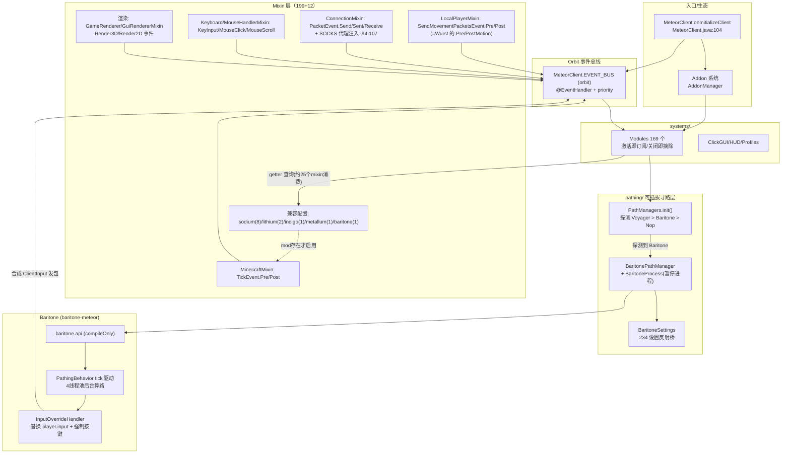

> 分析对象：Meteor 官方开源仓库（Meteor Client，Fabric，MC 26.3，Java 25，loader 0.19.5，fabric-api 0.162.0+26.3）
> 前置模组：`meteor-client-master\baritone-26.3\`（Meteor 维护的 Baritone fork，mod id `baritone-meteor`，MC 26.3-SNAPSHOT）——本报告仅分析其**依赖相关部分**与架构骨架。
> 规模：Meteor 949 个 Java 文件（199 个已注册 Mixin）、6 类 169 个模块、39 命令（Brigadier）、68 个事件类；Baritone 多源集（api/main/launch/fabric），API 设置项 234 个，自身 21 个 Mixin。
> 路径约定：Meteor 路径相对 `src/main/java/meteordevelopment/meteorclient/`；Baritone 路径相对 `baritone-26.3/`。事实均附 `文件:行号`，推断标 `[推断]` 归第 8 节。与 Wurst 报告同口径：只转述源码自带的反作弊相关机制，不提供源码外的规避建议。
>
> **配套文档（四件套）**：② [Meteor-功能实现详解.md](../article.html?post=2026-10-26-Meteor功能实现详解)（169 模块逐个机制 + 反作弊对照表）· ③ [Meteor-功能详解-补充卷.md](../article.html?post=2026-10-27-Meteor功能详解补充卷)（流程图/算法图解/39 命令语法/演进考古）· ④ [Meteor-功能详解-补充卷2.md](../article.html?post=2026-10-28-Meteor功能详解补充卷2)（网络通信/Mixin 事件全表/渲染与 HUD/util 包）。本文件为总纲与 Baritone 依赖面。
> **跨项目对照**：与 Wurst7 的同功能实现对照见 [Wurst-vs-Meteor-同功能实现对照.md](../article.html?post=2026-10-29-Wurst-vs-Meteor同功能实现对照)。

---

## 1. 功能概述

Meteor Client 是一个以 **Fabric 客户端 Mod** 形态实现的 Minecraft 挂端，架构与 Wurst 同类但工程化程度更高：Mixin 注入（199 个）把原版 tick/渲染/网络/输入流重定向到基于 **Orbit 库**的事件总线（`MeteorClient.EVENT_BUS`，`MeteorClient.java:61`），6 大分类 169 个内置模块（Combat 29 / Player 31 / Movement 31 / Render 38 / World 24 / Misc 16，`systems/modules/Modules.java:408-596`）以 `@EventHandler` 注解订阅事件，**模块激活时才订阅总线、关闭时摘除**（`autoSubscribe`，`systems/modules/Module.java:90-110`）。它有完整的三方生态设计：addon 插件系统（`AddonManager.init()`，`MeteorClient.java:105`）、自定义访问扩展格式 **classtweaker**（等价 accesswidener，18 条）、对 Sodium/Lithium/Indigo/Metallum 的可选兼容 Mixin 配置，以及一个**可插拔的寻路抽象层 `pathing/`**——运行时探测 Voyager（自研寻路器）或 Baritone（本文前置），都不存在则降级为空实现 `NopPathManager`（`pathing/PathManagers.java:21-39`）。配置持久化用 **NBT 而非 JSON**（9 个 `.minecraft/meteor-client/*.nbt` 系统，`systems/System.java:36-39`）。

Baritone 部分是 **Meteor 官方维护的 Baritone fork**：发布到 `maven.meteordev.org`（`fabric/build.gradle:102-113`），包名仍是上游 `baritone.api`（`src/api/java/baritone/api/BaritoneAPI.java:18`），mod id 改为 `baritone-meteor` 并检测原版 Baritone 防同装（`fabric/.../FabricMixinPlugin.java:39`）。它为 Meteor 提供 A\* 寻路、挖矿、区域清理、跟随四类 Process 能力与 234 个设置项。

---

## 2. 项目与入口背景

### 2.1 基本信息对照

| 项 | Meteor | Baritone fork |
|---|---|---|
| MC / Java | 26.3 / 25（`gradle/libs.versions.toml:3-6`） | 26.3 / 25（`gradle.properties`） |
| 入口 | `meteordevelopment.meteorclient.MeteorClient`（`fabric.mod.json:21-28`） | **无 entrypoint**（fabric.mod.json 空对象），靠 Mixin 初始化（见 5.1） |
| Mixin 配置 | 主 + baritone/indigo/lithium/sodium/metallum 共 6 份 | `mixins.baritone-meteor.json`（21 条） |
| 访问扩展 | `meteor-client.classtweaker`（自定义格式，18 条 accessible） | （常规流程） |
| 对方引用 | `compileOnly(libs.baritone)` = `meteordevelopment:baritone:26.1-SNAPSHOT`（`build.gradle.kts:88`、`libs.versions.toml:16,55`） | 发布 groupId `meteordevelopment`（`fabric/build.gradle:102`） |
| 注册表 | `Systems.init()` 显式 new 全部模块，**无反射扫描**（`Modules.java:77-84,408-596`） | `BaritoneAPI` 静态块反射实例化 `baritone.BaritoneProvider`（`BaritoneAPI.java:33-42`） |

### 2.2 初始化流程（`MeteorClient.onInitializeClient`，`MeteorClient.java:104-141`）

1. `AddonManager.init()`（:105）→ 为每个 addon 注册事件 lambda 工厂（MethodHandles Lookup，:108-114，Orbit 要求）；
2. `ReflectInit.registerPackages()` + `ReflectInit.init(PreInit.class)`（:117,120）——用 **reflections 库**扫描各 addon 包的 `@PreInit` 静态方法并按依赖拓扑执行（`utils/ReflectInit.java:38-53`）；
3. `Categories.init()`（:123，6 个 Category 类实例 + addon 扩展点）→ `Systems.init()`（:126，**先 Modules 再 Config**，然后 Macros/Friends/Accounts/Waypoints/Profiles/Proxies/Hud，`systems/Systems.java:36-57`）；
4. `EVENT_BUS.subscribe(this)`（:129）→ addon `onInitialize` → `Modules.get().sortModules()`；
5. `Systems.load()`（:138）→ `ReflectInit.init(PostInit.class)`（:141）→ JVM shutdown hook 保存全部系统（:144-148）。
6. 关键的依赖排序：`Commands` 的 `@PostInit(dependencies = PathManagers.class)`（`commands/Commands.java:30`）——**命令系统在 path manager 探测完成后才注册**。

### 2.3 目标功能的全部入口

| 入口 | 位置 | 说明 |
|---|---|---|
| ClickGUI | `systems/modules/render/` 之外的 GUI 框架（`gui/`：WidgetScreen + 主题 + widget 树） | `GuiThemes` 静态注册表，内置 MeteorGuiTheme，持久化 `gui/gui.nbt`（`gui/GuiThemes.java:22-35`） |
| HUD | `systems/hud/`（TextHud 等元素 + Starscript 模板） | `.nbt` 持久化 |
| 快捷键 | `Module.keybind` + `Modules` 按键逻辑（`Modules.java:217-301`） | `KeyInputEvent` 驱动 |
| 聊天命令 | **Brigadier**（区别于 Wurst 自研分发）：`ClientPacketListenerMixin.sendChat` HEAD 拦截（`mixin/ClientPacketListenerMixin.java:161-185`）→ Meteor 前缀命令 / `SendMessageEvent`；baritone 前缀的聊天不走 Meteor 事件（:163，`BaritoneUtils.getPrefix()`） |
| 配置 | 9 个 `.nbt`（modules/config/macros/friends/accounts/waypoints/profiles/proxies/hud），临时文件+原子 move，损坏自动备份（`systems/System.java:45-105`） |
| 全局禁用 | JVM shutdown hook 保存（`MeteorClient.java:144-148`） |

---

## 3. 完整调用链

### 3.1 全局架构图

### 3.2 调用链 A：每 tick 模块执行（以 KillAura 为例）

1. `Minecraft.tick` → `mixin/MinecraftMixin.java:114-133` HEAD/TAIL → `EVENT_BUS.post(TickEvent.Pre/Post)`（主线程，20/s）。
2. `systems/modules/combat/KillAura.java:286`（`@EventHandler(priority=…)` onTickPre）→ 目标筛选 `entityCheck`（:396-441：包围盒最近点距离 ≤ range、好友/创造/FakePlayer 过滤、`TargetUtils.getList` 按 priority 取 maxTargets 个）→ 冷却（:443：原版蓄力或 hitDelay 计数，`tpsSync` 除以 TPS）→ 旋转（RotationMode Always/OnHit/None，:353）→ `attack()`（:461）。
3. 攻击发包经 `MultiPlayerGameModeMixin`（`AttackEntityEvent` :103）→ `ConnectionMixin.send`（`PacketEvent.Send` :75）→ Netty。
4. 模块激活时才订阅：`Module.toggle()` → `EVENT_BUS.subscribe(this)`（`Module.java:90-110`）——**与 Wurst 的 onEnable 显式 `EVENTS.add(...)` 等价，但 Meteor 默认整个模块一键挂摘**。

### 3.3 调用链 B：Baritone 寻路执行（依赖面核心链）

1. **模块请求**：如 `AutoWalk` Smart 模式 → `PathManagers.get().moveInDirection(mc.player.getYRot())`（`systems/modules/movement/AutoWalk.java:178`）。
2. **抽象层分发**：`PathManagers.get()`（`pathing/PathManagers.java:16`）返回 `@PreInit` 时探测确定的实现——探测顺序 **Voyager → Baritone → Nop**（:22,:31,:34-35；探测即 `Class.forName`，:41-48，所以 Baritone 是 compileOnly、运行时可缺失，`build.gradle.kts:88`）。
3. **包装层**：`BaritonePathManager.moveInDirection`（`pathing/BaritonePathManager.java:87-90`）→ `ICustomGoalProcess.setGoalAndPath(GoalDirection)`；`GoalDirection.onTick` 每 20 tick 把目标点沿 yaw 推到玩家前方 100 格（:160-172），启发式引用 `BaritoneAPI.getSettings().costHeuristic`（:143-158）。
4. **Baritone 仲裁**：每 tick `MixinMinecraft` post `TickEvent` → `PathingBehavior.onTick`（`src/main/java/baritone/behavior/PathingBehavior.java:97-110`）→ `PathingControlManager.preTick/postTick`（:190-210）按 priority 让各 `IBaritoneProcess` 竞争控制权，胜者 `inControlThisTick`。
5. **算路**：当前 PathExecutor 段走完 → 同步块内 `findPathInNewThread` → **4 核心线程池**后台 A\*（`baritone/Baritone.java:58-62`；`PathingBehavior.java:196,505`；PathingControlManager.java:129-132 注释明言"用 tick 之间的时间算路"）。
6. **执行**：`InputOverrideHandler.onTick`（`src/main/java/baritone/utils/InputOverrideHandler.java:86-107`）在"在控制"时把 `ctx.player().input` 换成自有 `PlayerMovementInput`（按 `isInputForcedDown` 合成原版 `Input`，:97-99）——**客户端随后走原版物理与发包路径**；视角由 LookBehavior 经 `MixinClientPlayerEntity.aiStep` 重定向（`src/launch/resources/mixins.baritone-meteor.json`）。
7. **暂停**：Meteor 注册了一个自有 `BaritoneProcess`（`BaritonePathManager.java:197-227`），`isActive()`=暂停标志，激活时发 `PathingCommand(null, REQUEST_PAUSE)` 借用 Baritone 的进程抢占语义让出控制权 + `clearAllKeys()`——KillAura/AutoEat 等 pause-baritone 就是翻这个标志（`KillAura.java:355`、`AutoEat.java:199-231`）。

### 3.4 事件频率 / 线程总表

| 路径 | 频率 | 线程 | 触发点 |
|---|---|---|---|
| TickEvent.Pre/Post | 20/s | 主线程 | `MinecraftMixin.java:121,131` |
| SendMovementPacketsEvent.Pre/Post | 每 tick 位置包前后 | 主线程 | `LocalPlayerMixin.java:173-191` |
| PacketEvent.Send/Sent/Receive | 每包 | 主线程 / **Netty 读线程**（Receive） | `ConnectionMixin.java:46-83` |
| Render3D/Render2D | 每帧 | Render 线程 | `GameRendererMixin.java:129`、`GuiRendererMixin.java:85` |
| KeyInput/MouseClick/MouseScroll | 事件驱动 | 主线程 | `KeyboardHandlerMixin.java:52`、`MouseHandlerMixin.java:44,49` |
| Baritone TickEvent | 20/s | 主线程（算路在后台池） | `baritone/launch/mixins/MixinMinecraft.java:66-111` |
| 后台线程 | — | MeteorExecutor 池（TunnelESP `render/TunnelESP.java:215`、BlockESP `workerThread`）、Baritone 4 线程池、SwarmHost/Worker socket 线程、多渲染后台线程 | 各模块 |

注入技术统计：`@Inject` 248、`@Accessor` 69、`@ModifyExpressionValue` 66、`@ModifyReturnValue` 33、`@Unique` 93、`@ModifyArg` 16、`@ModifyArgs` 8、`@WrapOperation` 8、`@ModifyConstant` 3；**`@Overwrite` 与 `@Redirect` 均为 0**（全库扫描）——与 Wurst（无 @Overwrite 但仍用少量 Redirect 类注解）相比更保守。

---

## 4. 核心数据结构

| 名称 | 定义位置 | 关键内容 | 作用 |
|---|---|---|---|
| `EventBus`（Orbit） | `MeteorClient.java:61` | `subscribe/post`、`@EventHandler`、lambda 工厂（:108-114） | 全部 68 个事件类的总线 |
| `Module` | `systems/modules/Module.java:29-187` | settings 树/keybind/serialize/runInMainMenu/autoSubscribe/随机颜色/addon 归属（:65-73） | 模块基类；NBT 序列化含 active 状态 |
| `Modules` | `systems/modules/Modules.java:58-596` | 显式 add 169 个；进退服重新订阅活跃模块（:317-339）；Baritone 缺席时少注册 2 个（:573-576） | 模块注册表 |
| `Setting` 体系 | `settings/Setting.java:21-209`（32 个具体类型 + SettingGroup/IVisible） | 流式 Builder、`parse()` 命令字符串解析、颜色自动进 RainbowColors（`Settings.java:102-114`） | GUI 由 `DefaultSettingsWidgetFactory` 按 Setting 类型生成 widget |
| `System` | `systems/System.java:36-105` | `<名>.nbt` 绑定、原子保存、损坏备份 | 9 个持久化系统 |
| `IPathManager` / `ISettings` | `pathing/IPathManager.java:16-58` | moveTo/moveInDirection/mine/follow/pause/resume + walkOnWater/Lava/step/noFall 四项桥接 | 寻路抽象接口（Voyager/Baritone/Nop 三实现） |
| `BaritoneSettings` | `pathing/BaritoneSettings.java:70-204,220-418` | **反射遍历 Baritone 234 个设置**生成 Meteor UI 包装；特殊映射 `assumeWalkOn*`→walkOn*、`maxFallHeightNoWater`(int)→Bool `noFall`（开=写 159159，判 ≥255，:138-146） | 全量设置桥 + 4 项语义映射 |
| `IPathManager` 消费者 | 见 5.2 表 | — | 20+ 模块/命令/GUI |
| Baritone `IBaritone` | `src/api/java/baritone/api/IBaritone.java:41-140` | 12 个 Process + PathingControlManager + InputOverrideHandler + CommandManager | Baritone 门面接口 |
| Baritone `Settings` | `src/api/java/baritone/api/Settings.java` | 234 个 `public final Setting<T>` | 全部行为开关（`SettingsUtil` 持久化） |

模块分类计数（`Modules.java` 注册行）：Combat 29（:408-438）、Player 31（:440-472）、Movement 31（:474-506）、Render 38（:508-547）、World 24（:549-577，Excavator/InfinityMiner 仅 Baritone 存在时注册）、Misc 16（:579-596）。

---

## 5. 关键流程详解

### 5.1 Baritone 无 entrypoint 的初始化（依赖形态的关键）

`baritone-meteor` 的 fabric.mod.json **entrypoints 为空对象**，仅声明 mixins。初始化链：`MixinMinecraft.postInit` 在 `Minecraft.<init>` RETURN 处调用 `BaritoneAPI.getProvider().getPrimaryBaritone()`（`src/launch/mixins/MixinMinecraft.java:58-64`）→ 触发 `BaritoneAPI` 静态块：new Settings + `SettingsUtil.readAndApply` 读默认配置 + 反射 `baritone.BaritoneProvider` 实例化（`BaritoneAPI.java:33-42`）→ `BaritoneProvider` 构造 primary 实例（`BaritoneProvider.java:44-51`）。`[推断]` 这解释了 Meteor 用 `Class.forName` 探测即可安全可选依赖：Baritone 要么被 Fabric 作为 mod 装载（mixin 驱动自初始化），要么完全不在类路径。

### 5.2 Meteor 对 Baritone 的完整消费清单

**A. 经 `PathManagers` 抽象层**（不感知 Baritone 类型）：

| 消费者 | 用法 | 位置 |
|---|---|---|
| AutoWalk | Smart 模式 `moveInDirection(yaw)`；Nop 时警告自关 | `movement/AutoWalk.java:114,178` |
| Freecam | click-to-path `moveTo(pos)` | `render/Freecam.java:369` |
| WaypointsModule | goto 按钮 `moveTo(waypoint.getPos())` | `render/WaypointsModule.java:253-256` |
| StashFinder | stash 跳转 `moveTo(区块中心, ignoreY=true)` | `world/StashFinder.java:336,446` |
| SwarmWorker | 集群指令 `stop(); mine(target)` | `misc/swarm/SwarmWorker.java:71,81` |
| KillAura / BowAimbot | pause-baritone：`isPathing()` 检测 + `pause()/resume()` | `KillAura.java:355,375`、`BowAimbot.java:117,124` |
| AutoEat / AutoGap | 吃东西时暂停寻路 | `AutoEat.java:199-231`、`AutoGap.java:215-246` |
| Jesus / Step / NoFall | 设置同步：`getSettings().getWalkOnWater()/getStep()/getNoFall()` | `Jesus.java:180-190`、`Step.java:72-91`、`NoFall.java:103-111` |
| LocateCommand | stronghold `follow(EyeOfEnder)` / `findByBlockList`（`WorldScanner.scanChunkRadius`） | `commands/LocateCommand.java:186,193,303-312` |
| SwarmCommand | 集群 goto/box/mine 广播（Host 发原始命令串，Worker 当本地命令执行） | `commands/SwarmCommand.java:154,174,349,387` |
| GUI / Starscript / ChatUtils | PathManagerTab 设置面板；`baritone.is_pathing` 变量；坐标可点击设为 Baritone goal | `gui/tabs/builtin/PathManagerTab.java`、`MeteorStarscript.java:101`、`ChatUtils.java:259-266` |

**B. 直接调用 `baritone.api`**（2 个模块）：`Excavator`（选区 + `getBuilderProcess().clearArea`，`world/Excavator.java:26,90-91,126-138`）、`InfinityMiner`（状态机：挖矿/耐久修复/回家/背包满 logOut，直接改 `mineScanDroppedItems.value` 与 `mostRecentInControl()` 判定，`world/InfinityMiner.java:100-101,114-115,122-132,159-174,204-226`）。

**C. Mixin 级**：唯一一个注入 Baritone 类的 mixin `ComeCommandMixin`——`@ModifyArgs` 拦 `ICustomGoalProcess.setGoalAndPath`（`remap=false`，因目标是外部 mod 的非混淆类），Freecam 开启时把 `.come` 命令目标改为 Freecam 坐标（`mixin/baritone/ComeCommandMixin.java:19-28`）；由 `MixinPlugin` 按 `isModLoaded("baritone")||isModLoaded("baritone-meteor")` 门控（`MixinPlugin.java:38,61-62`）。

**D. 设置桥**：`BaritoneSettings.createWrappers()` 反射包装全部 234 项进 Meteor GUI（PathManagerTab）；4 项程序化映射（walkOnWater/Lava、step、noFall→`maxFallHeightNoWater=159159`）；保存走 `SettingsUtil.save`（`BaritoneSettings.java:59-61`）。

### 5.2 附：模块侧 Baritone 联动的三种模式（对比 Wurst）

1. **控制权移交**（AutoWalk Smart、Excavator、InfinityMiner、Swarm）——移动完全交给 Baritone；
2. **暂停/恢复**（KillAura、AutoEat、AutoGap、BowAimbot）——Baritone 在寻路时这些模块发 `pause()`，经 `REQUEST_PAUSE` 进程抢占；
3. **语义同步**（Jesus/Step/NoFall）——把 Meteor 模块状态写入 Baritone 的假设性设置（assume\*），使 Baritone 寻路时把水当地面/自动上台阶/无视摔落。`[推断]` 三种模式合起来解决"战斗/生存自动化与寻路共存"的问题——这是 Wurst 完全没有的能力面。

### 5.3 错误/异常路径

- **Baritone 缺失**：`PathManagers` 落到 `NopPathManager`（全空实现 + 单 BoolSetting 的 `NopSettings`，`NopPathManager.java:17-109`）；Excavator/InfinityMiner 不注册（`Modules.java:573-576`）；AutoWalk Smart 警告自关（`AutoWalk.java:114-117`）。
- **配置损坏**：`.nbt` load 失败自动备份为 `<名>-<时间戳>.backup.nbt`（`System.java:90-105`）。
- **原版 Baritone 同装**：Baritone fork 的 `FabricMixinPlugin` 禁用自身全部 mixin（`fabric/.../FabricMixinPlugin.java:50-56`）；Meteor 的 MixinPlugin 对两个 id 都认（`MixinPlugin.java:38`）。
- **Swarm**：host 端口占用则 socket=null 不启动（`SwarmHost.java:22-24`）；worker 断线仅 `PathManagers.stop()`（`SwarmWorker.java:71`）。
- Meteor 侧未见 Wurst 式"事件异常包 CrashReport"的统一策略；`[推断]` Orbit 异常会沿 post 调用栈抛出到 Mixin 注入点（行为未在本次扫描中单独验证）。

---

## 6. 与游戏机制的交互点

### 6.1 交互矩阵（按类别归纳，行号见探索明细）

| 游戏层 | 手段 | 代表模块 |
|---|---|---|
| 移动/物理 | `PlayerMoveEvent` 改向量、JumpVelocityMultiplier/CollisionShape/CanWalkOnFluid 事件、`Attributes.STEP_HEIGHT.setBaseValue`（Step.java:77）、Timer 改 `DeltaTracker`（`world/Timer.java:33-35` + `RenderTickCounterDynamicMixin:25`） | Speed（Vanilla/Strafe 两模式，Strafe 是 4 阶段 NCP 风格状态机且带 0.43/0.44 限速+1250/2500ms 时间窗，`movement/speed/modes/Strafe.java:57-63`）、Flight（Velocity/Anti-Kick：Rot 包升级为含 Y 包且 Y=lastY−0.03130，`movement/Flight.java:178-188`）、Jesus、ElytraFly（Vanilla/Packet/Pitch40/Bounce 四模式，Packet 模式发 START_FALL_FLYING 伪造飞行）、LongJump、Blink、ClickTP（≤210 格按每 10 格一个 StatusOnly 包拆分瞬移，`movement/ClickTP.java:83-88`）、Burrow（4 包顶出+回弹卡方块） |
| 输入 | `KeyInputEvent/MouseClickEvent` + 模块 `setDown`；**Baritone 整体替换 `player.input`** | AutoClicker、AirJump、GUIMove、Sprint（攻击前 STOP_SPRINTING 保暴击再恢复，`movement/Sprint.java:79-95`） |
| 网络包 | `PacketEvent.Send/Sent/Receive`（Receive 在 Netty 线程，bundle 拆包）、`meteor$` 接口改包 | Velocity（改 `ClientboundSetEntityMotionPacket`）、AntiHunger（onGround=false + 落地放行真包，`player/AntiHunger.java:57-68`）、Criticals（6 种模式，spoof 包打 tag 1337 与 NoFall 协作，`combat/Criticals.java:180,196`）、ServerSpoof（伪品牌包+blockChannels 取消 fabric 注册包+伪资源包三连回执，`misc/ServerSpoof.java:91-120`）、AntiPacketKick（解压帧截断/吞异常，`misc/AntiPacketKick.java:33` + 4 个 Mixin）、BuildHeight、PacketCanceller/Logger、TimeChanger/WeatherChanger |
| 方块交互 | `StartBreakingBlockEvent/BreakBlockEvent/BlockBreakingCooldownEvent/PlaceBlockEvent/InteractBlockEvent` | Nuker（Flatten/Smash/Layer × Sphere/UniformCube/Cube 形状，三破坏模式）、PacketMine、SpeedMine（**grim-bypass：STOP 前补发上邻格 ABORT 包**，引用 Grim issue #1296，`player/SpeedMine.java:121-124`）、Scaffold、LiquidFiller、Excavator（Baritone） |
| 容器/物品 | `InventoryEvent/ContainerSlotUpdateEvent` + InvUtils | AutoTotem/Offhand（双离手模块，Smart 锁定=血量−可预支伤害）、AutoArmor、AutoReplenish、InventoryTweaks、AutoEat/AutoGap |
| 战斗 | `AttackEntityEvent/DoAttackEvent` + DamageUtils | KillAura（见 3.2）、CrystalAura（放/爆、face-place、smartDelay）、AnchorAura/BedAura（维度自检）、Surround/HoleFiller/AutoTrap/SelfTrap（建筑防御族）、ArrowDodge（弹道模拟+8 方向 shuffle 随机择向，`combat/ArrowDodge.java:130-132`）、Quiver、AutoCity、AntiAnvil/AntiBed（头顶威胁拆除） |
| 渲染 | Renderer3D/2D（MeshBuilder+`MeteorRenderPipelines`）、ESP/Outline 队列、IGpuDevice 四后端多态 | Xray（区块重建+alpha 掩码，13 个渲染 Mixin+sodium 7 个，Iris 下警告）、ESP/Tracers/StorageESP/HoleESP/LightOverlay/TunnelESP（后台线程池搜隧道）/BlockESP（别名 search，后台搜索+增量更新）、Marker（Cuboid/Sphere2d 自定义标记）、NoRender（40+ 开关、31 个 Mixin 消费）、Fullbright（Gamma/Potion/Luminance 三模式） |
| 聊天/社交 | ReceiveMessageEvent/SendMessageEvent | BetterChat（含 coordsProtection 坐标打码）、Spam、DiscordPresence（Starscript 编译）、Swarm（TCP 主从）、Notebot（.nbs 解码+音符盒调音状态机）、BookBot（Random 模式含 PaperMC 绕过注释，`misc/BookBot.java`） |
| 世界查询 | ChunkDataEvent/BlockUpdateEvent/BlockIterator | StashFinder（CSV/JSON 导出+Baritone 跳转）、NewChunks 类功能（`world/` 内 BlockUpdate 驱动）、HighwayBuilder（纯自研 10+ 状态机跑高速公路，`runInMainMenu=true`） |

### 6.2 版本兼容与第三方适配

- 深度绑定 MC 26.3 快照（新渲染后端 `renderpearl`：classtweaker 开放 `GlDevice`，`IGpuDevice` 四实现覆盖 vanilla OpenGL/Vulkan/Frontend + 第三方 Metallum 设备，`mixin/metallum/MetalDeviceMixin.java:14`）。
- 可选兼容配置全部由 `MixinPlugin.shouldApplyMixin` 按包前缀+mod 探测门控（`MixinPlugin.java:50-69`）；`MeshVertexConsumerMixin` 存在但未注册（死代码/预留）。
- Baritone fork 保留上游包名与作者署名（`fabric.mod.json` authors `leijurv,Brady`），仅发布坐标与 id 变更；本地源码 26.3-SNAPSHOT 比 Meteor 声明的 26.1-SNAPSHOT 新（见第 8 节）。

---

## 7. 边界条件与风险点（仅源码事实）

- **可选依赖契约**：Baritone 全链路 compileOnly + 运行时探测，任何一处缺失都有明确降级（Nop/不注册/警告自关）；`ComeCommandMixin` 与 Excavator/InfinityMiner 注册均门控。
- **线程面**：`PacketEvent.Receive` 在 Netty 线程（`ConnectionMixin.java:46`）；Baritone 算路在 4 线程池、执行在主线程（`PathingBehavior.java:196,505`）；TunnelESP/BlockESP 后台搜索均有 synchronized/锁（`TunnelESP.java` synchronized(chunks)）。
- **设置桥的脆弱点**：`BaritoneSettings` 反射依赖 Baritone 设置字段名与类型（Boolean/Double/…/List<Block>），fork 改名/改类型会使对应包装失败；`noFall` 映射用魔数 159159/255 阈值（`BaritoneSettings.java:138-146`）。
- **Swarm 暴露面**：Host 开 TCP 端口（默认 6969）广播命令、Worker 无条件执行 `Commands.dispatch`（`SwarmWorker.java:34-62`）——局域网内任何能连上端口的进程可驱动 Worker `[推断：无鉴权，源码未见认证逻辑]`。
- **版本错位**：本地 baritone-26.3 (26.3-SNAPSHOT) 与 Meteor 声明依赖 26.1-SNAPSHOT 不同版；`[推断]` 同时装两者会以 Meteor 编译针对的 26.1 API 为准，API 若有变动存在运行时 NoSuchMethodError 风险。
- 源码自带反作弊相关机制的转述口径同 Wurst 报告：Speed 的 speed-limit 时间窗（`Strafe.java:57-63`）、SpeedMine 的 ABORT 包序列（:121-124）、Flight 的 −0.03130（:178-188）、Criticals 的 6 模式常量、ServerSpoof 的 blockChannels 等仅陈述实现，不含源码外的规避建议。

---

## 8. 待确认问题（均为 `[推断]`）

1. `PathManagers.init` 优先探测 `meteordevelopment.voyager.PathManager`（:22）——Voyager 是 Meteor 的新一代寻路器但**不在本仓库**，其成熟度/是否已发布未知；若同时存在 Voyager 与 Baritone，Baritone 面板（PathManagerTab）将不可见。
2. Meteor 依赖 baritone 26.1-SNAPSHOT 而本地 fork 是 26.3-SNAPSHOT：是待更新、快照命名差异还是故意留旧 API 面，需作者确认。
3. `Commands` 无独立 `.goto` 命令（goto 散在 Waypoints/ChatUtils/Baritone 自身 `#goto`）——是设计取舍还是遗漏。
4. Orbit 事件处理器抛异常的最终行为（崩溃/吞掉）未在本次扫描中验证。
5. `sodium/MeshVertexConsumerMixin` 未注册进任何配置——预留或遗忘。
6. Baritone fork 相对上游的功能差异只有间接线索（`allowWalkOnMagmaBlocks`/`elytraUseCache` 等新增设置、meteordev maven），无 CHANGELOG 可比对。
7. `BaritoneSettings` 的 `maxFallHeightNoWater=159159` 魔数是否对应 Baritone 某内部阈值语义（≥255 即视为"永不摔死"）需对照 Baritone 实现确认。

---

## 9. 参考索引（节选，全部结论均可在正文对应行号复核）

- 入口/初始化：`MeteorClient.java:50-148`、`systems/Systems.java:36-72`、`utils/ReflectInit.java:10-83`
- 事件/模块/设置：`Module.java:29-187`、`Modules.java:58-596`、`settings/Setting.java`、`systems/System.java:36-105`
- Mixin：`mixin/MinecraftMixin.java`、`mixin/LocalPlayerMixin.java`、`mixin/ClientPacketListenerMixin.java`、`mixin/ConnectionMixin.java`、`MixinPlugin.java:30-69`、`meteor-client.classtweaker`（18 条）
- 模块明细：`systems/modules/combat/*`（28）、`player/*`（31）、`movement/*`（31 含 speed/elytrafly 子包）、`render/*`（36 含 blockesp/marker）、`world/*`（24）、`misc/*`（15+swarm）
- **Baritone 依赖面**：`pathing/PathManagers.java:14-48`、`pathing/IPathManager.java:16-58`、`pathing/BaritonePathManager.java:36-227`、`pathing/BaritoneSettings.java:59-204`、`pathing/NopPathManager.java`、`BaritoneUtils.java:11-22`、`mixin/baritone/ComeCommandMixin.java`、`world/Excavator.java`、`world/InfinityMiner.java`、`commands/LocateCommand.java:165-312`、`commands/SwarmCommand.java`
- **Baritone 架构**：`src/api/java/baritone/api/BaritoneAPI.java:33-42`、`IBaritone.java:41-140`、`Settings.java`（234 项）、`src/main/java/baritone/behavior/PathingBehavior.java:97-215`、`src/main/java/baritone/Baritone.java:58-62`、`src/main/java/baritone/utils/InputOverrideHandler.java:44-107`、`src/main/java/baritone/utils/pathing/PathingControlManager.java:47-210`、`src/launch/mixins/MixinMinecraft.java:58-128`、`mixins.baritone-meteor.json`（21 条）、`fabric/src/main/java/baritone/launch/FabricMixinPlugin.java:39-56`
- 构建：`build.gradle.kts:21-29,88`、`gradle/libs.versions.toml:3-6,16,55`、`baritone-26.3/fabric/build.gradle:102-113`
