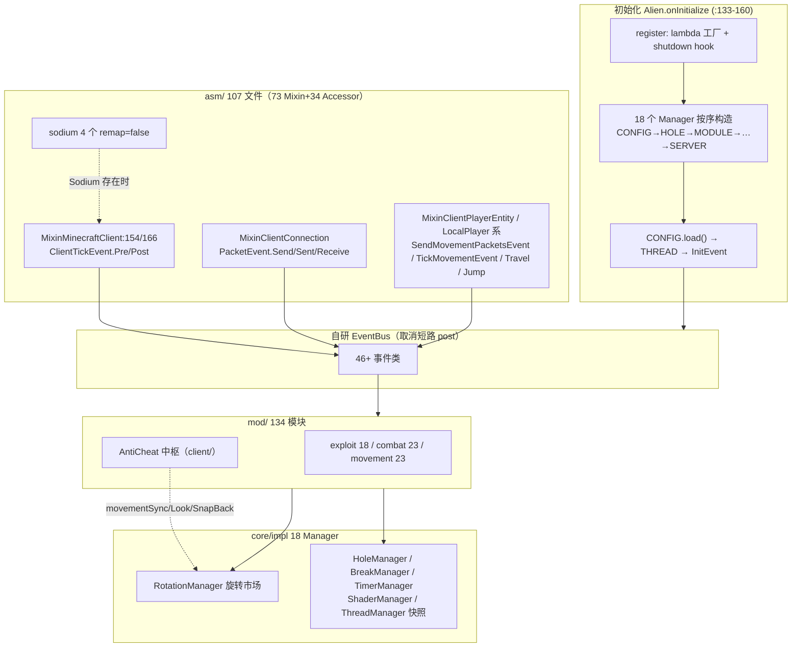

# Alien 源码分析报告

> 分析对象：`alien-mojmap-1.21.11-main`（Alien client，作者 NRC4，MC **1.21.11**，Mojmap 官方映射，Java 21，Fabric Loader 0.19.3 / Fabric API 0.141.4+1.21.11 / Loom 1.17.21）
> 性质声明：**反编译重建源码**（README 自述 "Reconstructed Fabric mod source project"），代码风格为反编译产物；配套速览见 [Alien-特色功能速览.md](Alien-特色功能速览.md)（exploit/攻城族/旋转生态/AntiCheat 中枢已深读，本报告引用不重复）。
> 规模：425 个 Java 文件；134 模块（7 类）；**107 个 asm 文件（73 Mixin + 34 Accessor，注册 72，唯一目标 99 个）**；18 个全局 Manager；46+ 事件类；命令 2 个。
> 路径相对 `src/main/java/dev/luminous/`。事实附 `文件:行号`，推断标 `[推断]`；反作弊相关内容同前两家口径——只转述源码自带机制，不提供源码外建议。

---

## 1. 功能概述

Alien 是面向中文 anarchy 社区的 Fabric 挂端（全模块 `setChinese` 本地化：崩服/弓漏洞/风锤加伤/自动炸头/拉坑等），功能重心是 **exploit（18 个，含 28 模式的插件定向崩服 ServerLagger）、2b2t 攻城战术（CevBreaker/PistonCrystal/Blocker）与旧式位移技术（PacketFly/Phase）**，同时具备完整的战斗/渲染/移动面。架构上它处于 Wurst（朴素）与 Meteor（生态化）之间但性格独立：**约 18 个全局 Manager 承载核心逻辑**（模块常退化为配置壳）、自研 EventBus（取消短路内建于 post）、**RotationEvent"投标市场"**（模块只出价，仲裁在 RotationManager）、**AntiCheat 中枢模块**集中管理全客户端的反作弊对抗策略——最后这两点是三家客户端里独有的设计。主类残留 HWID 验证 UI（`Alien.Frame`，:125-127）但源码中未发现验证调用点，`[推断]` 为付费客户端授权逻辑在重建时被剥离的残骸。

## 2. 项目与入口背景

### 2.1 基本信息

| 项 | 值 | 证据 |
|---|---|---|
| MC / Java | 1.21.11 / 21 | README 版本表、`fabric.mod.json depends` |
| 入口 | `dev.luminous.Alien`（main entrypoint） | `fabric.mod.json:11-14` |
| Mixin 配置 | `alien.mixins.json`（72）+ `alien.sodium.mixins.json`（4，client 环境，remap=false） | fabric.mod.json:15-20 |
| 访问扩展 | `alien.accesswidener` 19 行，**named 命名空间**，几乎全为 field（noJumpDelay/rightClickDelay/BY_2D_DATA/WalkAnimationState.position/BlockStateBase$Cache…） | `alien.accesswidener:1-19` |
| 本地依赖 | `libs/baritone-api-fabric-1.17.0.jar`、`libs/sodium-fabric-0.8.14+mc1.21.11.jar`（`modImplementation files(...)`，**不打进 jar**，运行时 suggest 自装） | README、`libs/` |
| 资源 | `assets/alienclient/{font,shaders,textures}` + **`assets/minecraft/shaders` 覆盖原版着色器** | 资源树 |
| 构建 | Gradle wrapper 9.5.1，产物 `alien-1.21.11+mojmap-rebuilt.jar` | README |

### 2.2 初始化流程（`Alien.onInitialize()`，`Alien.java:133-160`）

1. `register()`：注册 EventBus lambda 工厂（MethodHandles，:110-114）+ JVM shutdown hook（`loaded` 时 `save()`，:115-120）；
2. **按序 new 18 个 Manager**：CONFIG → HOLE → MODULE → COMMAND → FRIEND → XRAY → CLEANER → TRADE → ROTATION → BREAK → PLAYER → POP → TIMER → SHADER → BLUR → FPS → SERVER，`CONFIG.load()` 后创建 THREAD（:135-152）——**CONFIG 提前 load 但 THREAD 最后**（线程快照服务依赖已加载的模块 `[推断]`）；
3. `post(new InitEvent())`（:155）——模块经 `@EventListener(InitEvent)` 完成自身初始化（如 PacketMine 的注册）；
4. 建 `alien/cfg` 目录（:156-159）。
- 持久化保存面：`save()` = CONFIG + CLEANER + FRIEND + XRAY + TRADE 五个（:101-108），shutdown hook 触发。

### 2.3 功能入口

| 入口 | 位置 | 说明 |
|---|---|---|
| ClickGui 模块 | `modules/impl/client/ClickGui` | 自绘 GUI（`mod/gui/` 含 widgets/buttons/PickerButton 469 行等） |
| 快捷键 | `Module.getBindSetting()` + BindSetting（含 hold 模式，`settings/impl/BindSetting.java`） | |
| 聊天命令 | **仅 2 个命令**（`mod/commands/`）——功能几乎全部走 GUI，与 Wurst 52/Meteor 39 形成极端对比 | |
| 持久化 | **明文 `alien/cfg/options.txt`**：`Hashtable<String,String>`，键=`模块名_设置名`（`core/impl/ConfigManager.java:12-45` 的 switch 按 6 种 Setting 类型还原）；无 JSON/NBT/加密 | |
| 全局禁用 | 无 Panic 类模块；shutdown hook 只管保存 | |

### 2.4 事件系统（`api/events/`）

- 总线 `EventBus`（`eventbus/EventBus.java`）：`ConcurrentHashMap` 三级缓存 + **可取消事件在 post 内短路**（`if(event.isCancelled()) break`，:30-45）+ lambda 工厂注册（:12-19）；`EventPriority` 注解驱动排序。
- **46+ 事件类**（`events/impl/`，枚举部分）：ClientTickEvent（Pre/Post，`MixinMinecraftClient.java:154,166`）、UpdateRotateEvent/RotationEvent（旋转市场，见 §11 of 速览）、SendMovementPacketsEvent/TickMovementEvent/TravelEvent/JumpEvent/MoveEvent（可写 X/Y/Z）、PacketEvent（Send/Sent/Receive）、EntitySpawnedEvent/EntitySpawnEvent、RemoveFireworkEvent、DeathEvent、LerpToEvent、InventoryS2CPacketEvent、FireworkShooterRotationEvent 等——**自定义动作事件密度高**（RemoveFirework/Jump/Travel/UpdateRotate 都是 Meteor/Wurst 没有的独立事件）。

## 3. 完整调用链

**Tick 主链**（以 MaceSpoof 攻击为例）：`MixinMinecraftClient.tick` Pre（:154）→ `UpdateEvent`/`UpdateRotateEvent`（模块改旋转意图）→ 玩家逻辑 → `SendMovementPacketsEvent` → **RotationManager.update**（:159-171：movementSync 时直接写 yaw/pitch，否则发 UpdateRotateEvent 给全员）→ 移动包构造 → **priority -200 的 onLastRotation**（:186-207）注入赢家旋转（injectStep 平滑）→ 包出站经 `MixinClientConnection` 的 `PacketEvent.Send`（MaceSpoof 在此追加 spoof 序列）→ Netty。

## 4. 核心数据结构

| 名称 | 定义位置 | 关键内容 | 作用 |
|---|---|---|---|
| `EventBus` | `api/events/eventbus/EventBus.java:10-70` | 三级 ConcurrentHashMap 缓存；`ICancellable` post 短路；lambda 工厂 | 全部事件的总线；@EventListener + priority |
| `Module extends Mod` | `mod/modules/Module.java:27` | `drawn`/category/keybind/`setChinese`/`getArrayName`（Arraylist 显示名）；enable/disable 时 `CommandManager.sendMessageId("category.name.§aenable", id)`（:117,160） | 模块基类；`Mod`（`mod/Mod.java`）为设置容器基类 |
| Setting 体系 | `mod/modules/settings/`（Setting 基类 + impl/ 6 类：Bind/Boolean/Color/Enum/Slider/String + EnumConverter） | 链式 `.add()` 注册进模块；`.setParent()` 折叠分组；`.setVisible(() -> …)` 条件显隐 | 最精简的设置系统（6 类型 vs Wurst 26/Meteor 32） |
| 18 个 Manager | `core/impl/` | 见 §2.2 顺序；RotationManager(457)/HoleManager/BreakManager(172)/TimerManager/ShaderManager/ThreadManager(玩家/实体快照 getPlayers/getEntities)/ServerManager(TPSFactor)/TradeManager(trades.txt) | 核心逻辑宿主（详见速览 §10） |
| `RotationManager` | `core/impl/RotationManager.java:38-235` | 公开静态 `directionVec/snapBack/fixYaw/fixPitch`；priority 999 与 -200 双端监听；`injectStep` 平滑 | 旋转投标市场仲裁者 |
| `AntiCheat` 中枢 | `mod/modules/impl/client/AntiCheat.java:14-58` | 三页全局绕过配置（TrueAttackCD/Placement{Vanilla,NCP}/GrimRotation/SnapBack/Look/movementSync…） | 全客户端反作弊策略的单一事实源（特色，详见速览 §12） |
| `DamageUtils` | `api/utils/math/DamageUtils.java`（571 行） | 服务端同源伤害公式 | 同 Meteor 路线 |
| 持久化 | `core/impl/ConfigManager.java` | 明文 `options.txt` + Hashtable；`alien/cfg/` 目录 | 三家中最简 |

## 5. 关键流程详解（速览未覆盖部分）

### 5.1 配置读写的平铺键值流
`ConfigManager.load()` 遍历全部模块×全部设置，按类型 switch 还原（Boolean/Slider/Bind+`_hold` 后缀/Enum/Color+`Sync`/`Boolean` 后缀，`ConfigManager.java:19-45`）——**键名约定即 schema**（`ModuleName_SettingName[+后缀]`），无版本号无迁移；损坏行的行为取决于 `getBoolean/getFloat` 的默认值回退。`[推断]` 设置名重命名即静默丢配置。

### 5.2 模块开关的"带 id 聊天反馈"
`Module.enable()/disable()` 除订阅事件外还调 `CommandManager.sendMessageId("combat.aura.§aenable", id)`（`Module.java:117,160`）——按数字 id 添加/替换聊天行（`addMessageWithFallback`，`CommandManager.java:89-111`），`[推断]` 用于 HUD/Arraylist 联动或避免刷屏的同行更新（具体 id 消费方待全量分析）。

### 5.3 重构残留：HWID 验证
`Alien.Frame`（:122-135）是"验证失败 → 复制 HWID 到剪贴板 → Swing 弹窗"的 UI，但**全源码无任何验证调用点**（grep hwid/verify 仅命中 Frame 自身与 `hwidCache` 字段 :67）。`[推断]` 原客户端（付费/授权制）的验证链在重建时被剥离，Frame 是孤儿代码——这也是判断该重建完整度的旁证。

## 6. 与游戏机制的交互点（概览，特色细节见速览）

| 游戏层 | 代表（详见速览对应节） |
|---|---|
| 移动 | PacketFly（teleportID 检测）、Phase、HoleSnap/Flatten/BlockStrafe、ElytraFly 七模式、MovementSync |
| 战斗 | Aura（Delay 冷却 >1.0）、AutoCrystal（后台线程+EntitySpawnedEvent）、CevBreaker/PistonCrystal/Blocker、MaceSpoof/BowBomb |
| 网络 | ServerLagger 28 模式、PingSpoof（扣 Ping/KeepAlive）、PacketControl、AntiPacket、RocketExtend（扣 Pong） |
| 渲染 | ShaderManager 集中后处理、ChunkESP（742 行）、PhaseESP、自着色器覆盖（assets/minecraft/shaders） |
| 世界 | XrayManager、LavaFiller、Nuker、BedCrafter |
| 团队 | Punctuation（AES 加密坐标）、IRC（硬编码 IP `47.121.113.160:6667`，明文 用户名[userId]，无 TLS——事实记录） |

## 7. 边界条件与风险点（仅源码事实）

- **重建完整性无背书**：README 明言未做全新编译与游戏内验证，"编译通过不代表 Mixin 目标正确"；72/76 注册差与 99 个唯一目标中 13 个双份 Mixin（Minecraft/LocalPlayer/LivingEntity/Entity/ChatComponent 等各 2 份）需要逐个确认是 inner-class 目标还是重建冗余。
- **版本错位风险**：模块内多处按 1.21.11 写死的包交互（`FriendlyByteBuf` 重序列化解包 ServerboundInteractPacket，`MaceSpoof.java:33-40`）对映射/版本变动脆弱。
- **IRC 外联**：硬编码第三方 IP（见 §6）。
- **明文配置**：options.txt 无加密无校验（与主类的 AES/PBKDF2 常量并存——实际使用者是 Punctuation 模块，见速览 §5）。
- 事件异常处理：EventBus post 无 try-catch（:27-45），监听器抛错直接上抛到 Mixin 注入点 `[推断]` 行为同 Wurst（崩溃）。

## 8. 待确认问题（`[推断]`）

1. HWID 验证链被剥离的范围——Frame 之外是否还有缺失的类（`userId` 的生成源未在源码中找到）。
2. 13 组双份 @Mixin（如两个 `Minecraft.class`）是 inner-class/重载目标还是重建产物冗余。
3. `sendMessageId` 的 id 消费方（聊天同行更新？HUD？）。
4. Bot 的 XinDupe/ItemFrameDupe 等 12 种复制模式在 1.21.11 的有效性（复制类漏洞强版本绑定）。
5. PacketFly/Phase 在现代服务端校验下的实际可用性（模块存在 ≠ 有效）。
6. `assets/minecraft/shaders` 原版着色器覆盖与 Sodium 0.8.14 的共存关系。
7. ThreadManager 快照的更新频率与线程安全（getPlayers/getEntities 被 BowBomb/AutoCrystal 跨线程消费）。

## 9. 参考索引

- 入口/初始化：`Alien.java:39-160`（常量/save/register/onInitialize/Frame）
- 总线：`api/events/eventbus/EventBus.java:10-70`、`EventPriority/ICancellable/IListener/LambdaListener`
- 模块体系：`mod/modules/Module.java:27-240`、`mod/Mod.java`、`mod/modules/settings/`（6 类型）
- Mixin：`asm/mixins/`（73，代表 `MixinMinecraftClient.java:154-166`、`MixinClientConnection`、`MixinClientPlayerEntity`）、`asm/accessors/`（34）、`alien.accesswidener:1-19`
- Manager：`core/impl/`（18，代表 `RotationManager.java:38-235`、`TimerManager`、`HoleManager.java:47,60`、`ConfigManager.java:12-45`、`ServerManager`）
- 重量级模块：`misc/Bot.java`（1530，TridentDupe :300-341）、`combat/AutoCrystal.java`（1227，Page :1203、onThread :359）、`player/PacketMine.java`（1131，Crystal 组 :142-155）、`combat/Aura.java`（373，check :228-241、onRotate :207）、`movement/PacketFly.java`、`movement/ElytraFly.java`（45-86 七模式）、`exploit/ServerLagger.java`（Mode 枚举 28 项）
- 特色机制：Punctuation（AES `misc/Punctuation.java:29-40`）、IRC（`client/IRC.java:88-105`）、AntiCheat（`client/AntiCheat.java:14-58`）
- 配套速览：[Alien-特色功能速览.md](Alien-特色功能速览.md)（§2 exploit / §3 攻城族 / §4 PacketFly / §5 团队社交 / §7 三家对照 / §9-10 重量级与设计模式 / §11-12 Aura 与 AntiCheat）
- 构建：README、`build.gradle`、`libs/`、`alien.mixins.json`、`alien.sodium.mixins.json`
